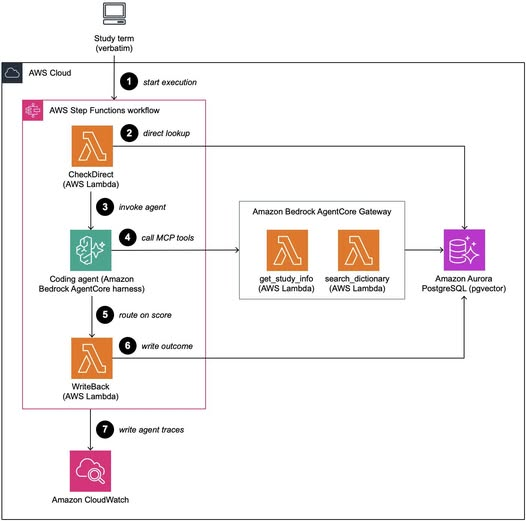

# Automating Medical Coding with AWS Step Functions and Amazon Bedrock AgentCore

Medical coding is the process of translating free-text clinical phrases such as *"migrane"* (misspelled) or *"flutters in my chest sometimes"* into standardized codes from dictionaries like **MedDRA** (adverse events) and **WHODrug** (medications). It is safety-critical—a single wrong code can route an event into the wrong safety signal—yet largely repetitive and traditionally reviewed term by term by human coders. Handing the entire workflow over to an autonomous agent makes the execution path dependent on model reasoning, making it difficult to review and reproduce.

AWS presents a reference pattern that resolves this tension by letting a deterministic workflow control the execution order while constraining the agent to make judgments inside a bounded step.

### Core Architecture Components

- **AWS Step Functions:** Orchestrates the pipeline (Standard Workflow), with each execution processing a single term and preserving full execution history for auditing.
- **AWS Lambda:** Executes deterministic processing steps (`CheckDirect`, `WriteBack`, and MCP tool handlers).
- **Amazon Bedrock AgentCore Harness & Gateway:** Runs the coding agent and exposes two MCP tools: `search_dictionary` and `get_study_info`.
- **Amazon Aurora PostgreSQL + pgvector:** Stores reference dictionaries and vector embeddings in a single database.
- **Amazon Bedrock:** Provides **Claude Sonnet 5** for agent reasoning and **Amazon Titan Text Embeddings V2** for semantic retrieval.

### Cost-Optimized Execution Flow

The pipeline follows a cost-first escalation strategy—resolving simple cases with the lowest-cost deterministic mechanism before invoking an LLM:

- **Direct Lookup:** Matches the input against predefined dictionary entries or synonym lists (via the `CheckDirect` Lambda function) using exact or synonym matching, resolving straightforward cases in the first step without calling an LLM.
- **Agentic Invocation:** Triggered only when direct lookup fails. The Coding Agent (running on **Amazon Bedrock AgentCore**) analyzes the term, retrieves dictionary candidates, and queries study context through MCP tools to disambiguate complex phrases.
- **Route on Confidence Score:** Decisions are routed based on the agent's confidence score:
  - **0.90 or higher:** Automatically accept and code the term.
  - **0.70 to below 0.90:** Route to human-in-the-loop review.
  - **Below 0.70:** Keep open for further review.
- **Outcome Persistence:** Before persisting data (via the `WriteBack` Lambda function), the system verifies that the selected code exists in the dictionary and stores the full hierarchy path alongside a concise explanation of the agent's reasoning.

### Why Confidence-Based Routing Beats Raw Embedding Similarity

One of the strongest aspects of this design is routing on **agent confidence** rather than raw embedding similarity alone:
- *"migrane"* scored only **0.37** in embedding similarity yet **0.97** in agent confidence, whereas *"flutters in my chest sometimes"* scored **0.65** in similarity but only **0.75** in confidence—embedding similarity alone would have ranked these two cases in the wrong order.
- The identical phrase *"cramps"* was coded as *"muscle spasms"* (**0.92**, auto-coded) in an oncology study and *"abdominal pain"* (**0.85**, routed to human review) in a reflux study because the agent read the study description via `get_study_info`.

### Caveats & Practical Notes

- **Reference sample only:** Not validated for clinical use; requires benchmarking against a labeled ground-truth dataset to measure accuracy and auto-coding error rates before production adoption.
- **Confidence score variance across runs:** Across six runs of the oncology *"cramps"* case, confidence ranged from **0.75 to 0.92** (2 auto-coded, 4 routed to review), though the selected code remained identical. Testing should evaluate the chosen code and account for score variance below 0.90.
- **Retrieval limits agent selection:** Because *"Palpitations"* ranked 19th in retrieval, the agent never considered it. The article recommends **hybrid retrieval** to improve candidate recall.
- **Licensing & compliance:** MedDRA and WHODrug require commercial licenses, and handling protected health information requires signing a BAA for HIPAA-eligible AWS services.
- **Cost driver:** The largest cost component is the **Aurora Serverless v2** cluster (minimum **0.5 ACU**, billed even while idle); the article does not publish an exact total cost estimate.
- **Scope boundary:** This pattern is not suited for open-ended conversational workflows where the agent itself must decide arbitrary next steps.

### Key Takeaway

I read this article to study a clean architectural separation: delegate **judgment** to the AI agent, while keeping **execution order, confidence thresholds, and audit trails** firmly under workflow control.

---

**Source:** *Automate medical coding with Step Functions and Amazon Bedrock AgentCore* — Sachin Doshi, Andrei Maksimov, Rostislav Markov, AWS Architecture Blog (October 21, 2026)  
**Link:** https://aws.amazon.com/blogs/architecture/automate-medical-coding-with-step-functions-and-amazon-bedrock-agentcore/  
**Tags:** `#AWS` `#FCAJ` `#AmazonBedrock` `#AgentCore` `#StepFunctions` `#GenerativeAI` `#AIAgents` `#MedicalCoding`
