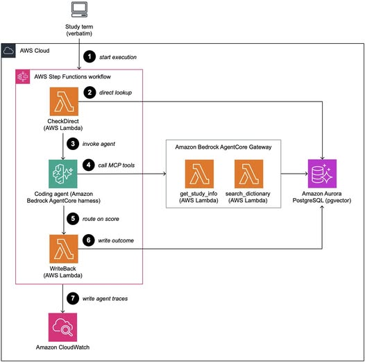

# Tự động hóa mã hóa y khoa với Step Functions và Amazon Bedrock AgentCore

Mã hóa y khoa (medical coding) là việc chuyển các cụm từ lâm sàng viết tự do như *"migrane"* (gõ sai) hay *"flutters in my chest sometimes"* thành mã chuẩn trong các bộ từ điển như **MedDRA** (biến cố bất lợi) và **WHODrug** (thuốc). Đây là việc nhạy cảm về an toàn vì một mã sai có thể đưa biến cố vào nhầm tín hiệu an toàn, nhưng phần lớn lại lặp đi lặp lại và do các coder xem từng thuật ngữ một. Nếu giao cả quy trình cho một agent, đường chạy sẽ phụ thuộc vào lập luận của mô hình, rất khó xem xét và tái hiện.

AWS giới thiệu một giải pháp mẫu giải quyết vấn đề này bằng cách để workflow quyết định thứ tự xử lý, còn agent chỉ phán đoán trong một bước có giới hạn.

### Các thành phần chính

- **AWS Step Functions:** Điều phối quy trình (standard workflow), mỗi execution xử lý một thuật ngữ và lưu lịch sử để kiểm toán.
- **AWS Lambda:** Chạy các bước xác định (deterministic).
- **Amazon Bedrock AgentCore harness và Gateway:** Chạy agent và cung cấp hai công cụ qua MCP là `search_dictionary` và `get_study_info`.
- **Amazon Aurora PostgreSQL + pgvector:** Lưu dữ liệu tham chiếu và embedding trong cùng một nơi.
- **Amazon Bedrock:** Cung cấp **Claude Sonnet 5** cho agent và **Amazon Titan Text Embeddings V2** cho tìm kiếm.

### Quy trình vận hành tối ưu hóa chi phí

Quy trình vận hành tuân thủ nguyên tắc tối ưu hóa chi phí (ưu tiên xử lý bằng phương thức có chi phí thấp nhất trước và chỉ leo thang sang các thành phần phức tạp hơn khi cần thiết):

- **Tra cứu trực tiếp (Direct Lookup):** Hệ thống tiến hành đối chiếu đầu vào với cơ sở dữ liệu từ điển hoặc danh sách thuật ngữ đã được định nghĩa sẵn (ví dụ thông qua hàm Lambda `CheckDirect`), thực hiện khớp chính xác hoặc tra cứu qua danh sách từ đồng nghĩa để giải quyết các trường hợp đơn giản ngay từ bước đầu mà không cần gọi mô hình ngôn ngữ lớn.
- **Kích hoạt AI Agent (Agentic Invocation):** Chỉ được kích hoạt khi bước tra cứu trực tiếp không thành công. Lúc này, Coding Agent (vận hành trên nền tảng **Amazon Bedrock AgentCore**) sẽ tiến hành phân tích sâu, tìm kiếm các ứng viên trong từ điển và truy xuất tài liệu chuyên sâu qua các công cụ MCP khi cần thiết để phân biệt các lựa chọn phức tạp.
- **Định tuyến theo điểm số tin cậy (Route on Confidence Score):** Quyết định xử lý được phân loại dựa trên điểm số đánh giá của agent:
  - **Từ 0,90 trở lên:** Tự động hóa quá trình xử lý/mã hóa.
  - **Từ 0,70 đến dưới 0,90:** Chuyển giao cho người kiểm duyệt (human-in-the-loop).
  - **Dưới 0,70:** Giữ lại trạng thái mở để tiếp tục xem xét.
- **Ghi nhận kết quả (Outcome Persistence):** Trước khi tiến hành ghi dữ liệu (thông qua hàm Lambda `WriteBack`), hệ thống kiểm tra sự tồn tại hợp lệ của mã trong từ điển, đồng thời lưu trữ cấu trúc cây phân cấp kèm theo một câu giải thích rõ ràng về cơ sở lý luận của quyết định.

### Cơ chế định tuyến theo độ tự tin vs độ tương đồng embedding

Một trong những điểm ưu việt của hệ thống là cơ chế định tuyến dựa trên độ tự tin của agent thay vì chỉ phụ thuộc vào độ tương đồng embedding thuần túy:
- *"migrane"* có độ tương đồng chỉ **0,37** nhưng độ tự tin **0,97**, còn *"flutters in my chest sometimes"* có độ tương đồng **0,65** nhưng độ tự tin chỉ **0,75**, nên độ tương đồng xếp hai ca này sai thứ tự.
- Ngoài ra, cùng từ *"cramps"* được mã hóa thành *"muscle spasms"* (**0,92**, tự động) trong nghiên cứu ung thư và *"abdominal pain"* (**0,85**, chuyển người duyệt) trong nghiên cứu trào ngược, nhờ agent đọc mô tả nghiên cứu.

### Lưu ý từ bài viết

- Mẫu chỉ để minh họa, không dùng cho lâm sàng. Cần kiểm chứng với bộ dữ liệu đã biết đúng và đo độ chính xác lẫn tỷ lệ tự động mã hóa sai trước khi dùng thật.
- Điểm tự tin dao động giữa các lần chạy: ca *"cramps"* ung thư dao động từ **0,75 đến 0,92** qua sáu lần chạy (2 lần tự động, 4 lần chuyển duyệt) nhưng mã được chọn không đổi. Nên kiểm thử theo mã được chọn và đặt ngưỡng có biên độ dưới 0,90.
- Agent chỉ chọn được thứ mà bước truy xuất tìm ra: mã *"Palpitations"* xếp hạng 19 nên không bao giờ được xét. Bài khuyến nghị truy xuất lai (hybrid).
- MedDRA và WHODrug là từ điển có bản quyền, cần đăng ký. Với dữ liệu sức khỏe cần ký BAA khi dùng các dịch vụ AWS đủ điều kiện HIPAA.
- Chi phí lớn nhất là cụm **Aurora Serverless v2**, tối thiểu **0,5 ACU** và tính tiền cả khi nhàn rỗi. Bài không đưa tổng chi phí cụ thể.
- Mô hình này không phù hợp với hội thoại mở, nơi agent phải tự quyết định bước tiếp theo.

### Nhận xét cá nhân

Mình đọc bài này để hiểu một hướng thiết kế: dùng agent cho phần cần phán đoán, còn thứ tự xử lý, ngưỡng và dấu vết kiểm toán vẫn do workflow nắm giữ.

---

**Nguồn:** *Automate medical coding with Step Functions and Amazon Bedrock AgentCore* — Sachin Doshi, Andrei Maksimov, Rostislav Markov, AWS Architecture Blog (21/10/2026)  
**Liên kết:** https://aws.amazon.com/blogs/architecture/automate-medical-coding-with-step-functions-and-amazon-bedrock-agentcore/  
**Thẻ:** `#AWS` `#FCAJ` `#AmazonBedrock` `#AgentCore` `#StepFunctions` `#GenerativeAI` `#AIAgents` `#MedicalCoding`
