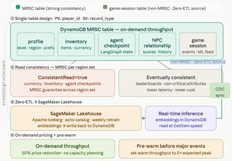

# Upgrading AI-Powered Game Backends with New Amazon DynamoDB Features

When integrating AI into games, the hardest engineering challenge is often not choosing the model, but choosing the state-storage infrastructure. A generative NPC that forgets every prior conversation, an AI dungeon master that loses the quest storyline mid-session, or an agent that loses state after an AWS Lambda cold start all share the same root cause: the lack of a durable, globally consistent state layer.

The AWS for Games Blog post highlights that **Amazon DynamoDB**—already widely used in game backends for player profiles, inventories, leaderboards, and session state—now introduces four enhancements tailored for AI-powered game workloads.

### Four Key Amazon DynamoDB Enhancements

- **Multi-Region Strong Consistency (MRSC):** Writes are synchronously replicated to at least one other Region before returning success, so reading with `ConsistentRead=True` from any replica returns the latest version. Under the hood, it uses a three-node multi-Region journal that commits once two of the three nodes confirm. The trade-off is single-digit millisecond additional latency, making it suitable for premium currency balances and agent checkpoints.
- **Zero-ETL to Amazon SageMaker Lakehouse:** DynamoDB automatically replicates table data to Lakehouse in **Apache Iceberg** format using incremental CDC synchronization (typically within minutes) without consuming production read capacity—replacing the traditional six-service pipeline (Streams, Lambda/Glue, S3, Glue Data Catalog, Athena).
- **LangGraph `DynamoDBSaver`:** Persists agent checkpoints and state (conversation history, tool outputs, NPC relationship scores, quest context) keyed by each player session's `thread_id`. Payloads exceeding **350 KB** are automatically offloaded to Amazon S3.
- **Pricing Reductions:** Effective November 1, 2024, on-demand throughput pricing was reduced by **50%** and Global Tables replication write pricing by up to **67%**.

### Reference Architecture Summary

The blog combines all four features into a reference design:
- Single-table design with partition key `player_id` and sort key `record_type`.
- Dedicated MRSC tables per Region set, using strong consistency (`ConsistentRead=True`) for premium currency and agent checkpoints, and eventual consistency for leaderboards.
- Zero-ETL enabled on the game-session table to retrain personalization models weekly in SageMaker Lakehouse.
- On-demand capacity mode with **warm throughput** pre-configured to **2× expected peak** ahead of major in-game events.

### Caveats & Critical Observations

- **MRSC feature limitations:** MRSC does not support TTL, Local Secondary Indexes (LSI), or transactional operations (`TransactWriteItems`, `TransactGetItems`). Data expiration must be handled manually via conditional writes or cleanup Lambda functions.
- **Regional-set boundary:** MRSC only operates within regional sets (US, Europe, Asia-Pacific) and does not yet provide cross-continent strong consistency. Studios with global players should use MRSC per regional set and accept eventual consistency for global leaderboards.
- **Zero-ETL prerequisites:** Enabling zero-ETL requires turning on Point-in-Time Recovery (PITR) on the source table and granting permissions to AWS Glue.
- **Cost example discrepancy:** The article cites 10 million writes per day across two replicas with pricing dropping from ~\$1.25 to \$0.625 per million WRUs, yet claims ~\$6,250/month in savings. Recalculating from those exact figures yields only about **\$375/month**, so teams should compute savings against their own actual traffic volumes.
- **Lack of empirical benchmarks:** The post describes architecture only and does not include measured latency, cost, or player-experience metrics.
- **Diagram vs. text nuance:** While the diagram refers to a "single-table design," it marks game-session records as outside MRSC—making it most logical to interpret game-session data as residing in a separate table serving as the zero-ETL source.

### Key Takeaway

I read this post to study a core design principle for AI in games: the quality of an NPC or AI agent’s player experience depends heavily on **durable, consistent state persistence**, not just the underlying model.

---

**Source:** *Level up your AI-powered game backend with Amazon DynamoDB new features* — Naveen Kantamneni, Jackie Jiang, AWS for Games Blog (October 21, 2026)  
**Link:** https://aws.amazon.com/blogs/gametech/level-up-your-ai-powered-game-backend-with-amazon-dynamodb-new-features/  
**Tags:** `#AWS` `#FCAJ` `#AmazonDynamoDB` `#AWSforGames` `#GameDev` `#GenerativeAI` `#AIAgents` `#LangGraph` `#SageMakerLakehouse` `#ZeroETL`
