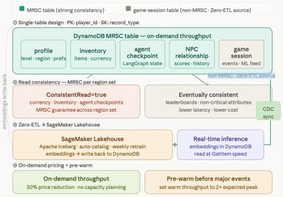

# Nâng cấp backend game dùng AI với các tính năng mới của Amazon DynamoDB

Khi đưa AI vào game, bài toán khó nhất thường không phải chọn mô hình mà là chọn hạ tầng lưu trạng thái. Một NPC sinh nội dung bằng AI quên sạch mọi cuộc trò chuyện, một người dẫn truyện (dungeon master) do AI điều khiển mất mạch truyện giữa nhiệm vụ, hay một agent mất trạng thái sau lần khởi động nguội (cold start) của Lambda đều có chung một nguyên nhân: thiếu lớp lưu trữ trạng thái bền vững và nhất quán trên toàn cầu.

Bài viết trên AWS for Games Blog cho rằng DynamoDB, vốn đã được nhiều backend game dùng cho hồ sơ người chơi, kho đồ, bảng xếp hạng và trạng thái phiên, nay có bốn cải tiến phục vụ trực tiếp backend game dùng AI.

### Bốn cải tiến chính của Amazon DynamoDB

- **Multi-Region strong consistency (MRSC):** Ghi được sao chép đồng bộ sang ít nhất một Region khác trước khi trả về thành công, nên đọc với `ConsistentRead=True` từ bất kỳ bản sao nào cũng trả về phiên bản mới nhất. Cơ chế nền là multi-Region journal gồm ba nút, xác nhận khi hai trong ba nút commit. Cái giá là độ trễ tăng thêm ở mức một chữ số mili giây. Phù hợp với tiền tệ premium và checkpoint của agent.
- **Zero-ETL với Amazon SageMaker Lakehouse:** DynamoDB tự sao chép bảng sang Lakehouse ở định dạng Apache Iceberg bằng đồng bộ gia tăng (CDC), thường trong vài phút, không tốn dung lượng đọc của bảng production. Thay cho pipeline gồm sáu dịch vụ trước đây (Streams, Lambda/Glue, S3, Glue Data Catalog, Athena).
- **LangGraph `DynamoDBSaver`:** Lưu checkpoint và trạng thái agent (lịch sử hội thoại, kết quả công cụ, điểm quan hệ với NPC, ngữ cảnh nhiệm vụ) theo `thread_id` của từng phiên người chơi. Payload trên **350 KB** được đẩy sang S3 tự động.
- **Giảm giá:** Từ 1/11/2024, giá thông lượng on-demand giảm **50%** và giá ghi nhân bản của global tables giảm tới **67%**.

### Kiến trúc tham chiếu

Bài đưa ra kiến trúc tham chiếu ghép bốn tính năng lại: một bảng với khóa phân vùng `player_id` và khóa sắp xếp `record_type`, bảng MRSC riêng cho từng nhóm Region, đọc nhất quán cho tiền tệ và checkpoint, đọc eventual cho bảng xếp hạng, bật zero-ETL trên bảng phiên chơi để huấn luyện lại mô hình cá nhân hóa hằng tuần, và chạy on-demand với warm throughput đặt ở mức gấp đôi đỉnh dự kiến trước các sự kiện lớn.

### Lưu ý từ bài viết

- MRSC không hỗ trợ TTL, Local Secondary Index và các thao tác giao dịch (`TransactWriteItems`, `TransactGetItems`). Việc hết hạn dữ liệu phải tự xử lý bằng ghi có điều kiện hoặc Lambda dọn dẹp.
- MRSC chỉ hoạt động trong từng nhóm Region (Mỹ, châu Âu, châu Á - Thái Bình Dương), chưa có nhất quán mạnh xuyên châu lục. Studio có người chơi toàn cầu nên dùng MRSC trong từng nhóm và chấp nhận eventual consistency cho bảng xếp hạng toàn cầu.
- Thiết lập zero-ETL cần bật PITR trên bảng nguồn và cấp quyền cho AWS Glue.
- Ví dụ chi phí trong bài khó kiểm chứng: 10 triệu mục ghi mỗi ngày qua hai bản sao, giá giảm từ khoảng 1,25 USD còn 0,625 USD mỗi triệu WRU, nhưng bài nêu khoản tiết kiệm khoảng 6.250 USD/tháng. Theo phép tính của mình từ chính các số đó, mức tiết kiệm chỉ khoảng **375 USD/tháng**, nên cần tự tính lại theo khối lượng thực tế.
- Bài không có số liệu đo lường độ trễ, chi phí hay trải nghiệm người chơi, chỉ mô tả kiến trúc.
- Sơ đồ nói “một bảng” nhưng lại đánh dấu bản ghi phiên chơi nằm ngoài MRSC, nên hợp lý nhất là hiểu dữ liệu phiên chơi nằm ở bảng riêng làm nguồn zero-ETL.

### Nhận xét cá nhân

Mình đọc bài này để hiểu một hướng nghĩ về AI trong game: chất lượng trải nghiệm của NPC và agent phụ thuộc nhiều vào việc trạng thái được lưu bền vững và nhất quán, chứ không chỉ vào mô hình.

---

**Nguồn:** *Level up your AI-powered game backend with Amazon DynamoDB new features* — Naveen Kantamneni, Jackie Jiang, AWS for Games Blog (21/10/2026)  
**Liên kết:** https://aws.amazon.com/blogs/gametech/level-up-your-ai-powered-game-backend-with-amazon-dynamodb-new-features/  
**Thẻ:** `#AWS` `#FCAJ` `#AmazonDynamoDB` `#AWSforGames` `#GameDev` `#GenerativeAI` `#AIAgents` `#LangGraph` `#SageMakerLakehouse` `#ZeroETL`
