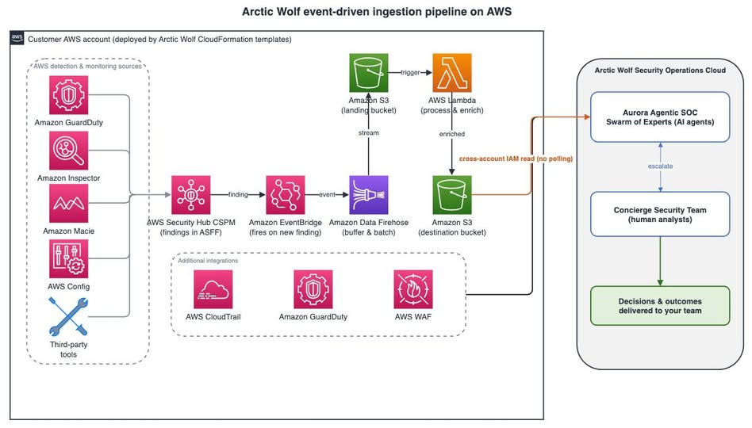

# Resolving Security Signals Faster with Arctic Wolf’s Aurora Agentic SOC

Security teams rarely suffer from a shortage of alerts—they suffer from a shortage of triage capacity. Detection tools generate far more alerts than human analysts can investigate, and the same signal can mean completely different things depending on the environment: a password-guessing pattern might be an authorized penetration test in one account and an active credential-stuffing attack in another. **Amazon GuardDuty** flags unusual API activity, but does not tell you whether it is a real incident, a misconfiguration, or authorized testing.

This AWS Marketplace Blog post (co-authored with two writers from Arctic Wolf) explains how **Arctic Wolf** combines AI agents with its **Concierge Security Team** to turn raw AWS security findings into actionable decisions.

### Core Architecture Components

- **Aurora Agentic SOC:** An AI-agent-driven security operations center built on the Aurora Superintelligence platform.
- **Swarm of Experts:** An agentic framework of specialized agents collaborating on triage, investigation, and response, with human analysts validating and taking over escalated cases.
- **Concierge Security Team:** Dedicated human specialists who understand the customer’s environment and act on their behalf.
- **AWS Security Hub CSPM:** Aggregates findings from Amazon GuardDuty, Amazon Inspector, Amazon Macie, AWS Config, and third-party tools into the standardized **ASFF** format.
- **Amazon EventBridge + Amazon Data Firehose + Amazon S3 + AWS Lambda:** An event-driven ingestion pipeline forwarding findings directly to the SOC.
- **AWS CloudFormation:** Templates provided by Arctic Wolf to deploy the entire ingestion pipeline inside the customer’s AWS account.

### Event-Driven Ingestion Flow

The ingestion pipeline operates without polling—findings are pushed immediately as they appear:

1. **AWS Security Hub CSPM** normalizes incoming findings into ASFF.
2. **Amazon EventBridge** emits an event whenever a new finding arrives.
3. **Amazon Data Firehose** buffers and streams events into a landing S3 bucket, handling sudden incident spikes smoothly.
4. **AWS Lambda** processes, enriches, and delivers the records into the destination S3 bucket.
5. **Arctic Wolf SOC** reads the destination bucket via cross-account IAM delegation (no polling) and correlates findings with endpoint, network, and identity telemetry in Aurora.

Beyond Security Hub, Arctic Wolf integrates with **AWS CloudTrail**, **Amazon GuardDuty** (single-account or multi-account via AWS Organizations / Control Tower), and **AWS WAF**, with over 120 alert rules reported across these integrations.

### Human-Agent Division of Labor

What stands out most is placing AI agents and humans in the roles where each excels: AI agents perform large-scale initial triage and correlation, while human experts handle complex judgment calls and customer communication. According to customer **CloudHesive** (cited in the post), reported outcomes included **50% fewer alerts requiring triage**, **99% faster investigation-to-remediation**, and **10× cost savings** compared to the estimated cost of building an in-house SOC.

### Caveats & Practical Notes

- **Vendor-authored metrics:** Because the article is co-authored by Arctic Wolf staff and closes with a subscription call-to-action, claims such as 10,000+ customers, 10+ trillion events per week, 14+ years of telemetry, and a 4.9/5 Gartner Peer Insights rating are vendor-provided without independent verification.
- **Self-reported customer results:** CloudHesive’s figures are customer-reported, and the 10× savings comparison is measured against an estimated in-house build cost rather than actual spend.
- **Escalation logic not detailed:** The article states that agents know when to stop and escalate to humans, but does not explain the mechanism or thresholds behind that decision.
- **Pricing model:** No list pricing is published. Arctic Wolf is procured via negotiated AWS Marketplace private offers (consolidated onto the AWS bill), while the in-account ingestion pipeline incurs standard AWS usage charges (estimable via the AWS Pricing Calculator).
- **Prerequisites:** Customers must enable AWS Security Hub and Amazon GuardDuty and hold an active Arctic Wolf subscription on AWS Marketplace.
- **Teardown & offboarding:** Removing the integration requires deleting the CloudFormation stacks (emptying any non-empty S3 buckets first) and notifying the Concierge team beforehand; deleting the stack only stops data ingestion and does not cancel the Marketplace subscription.

### Key Takeaway

I read this article to explore a practical blueprint for security operations: let AI agents shoulder high-volume triage and initial correlation, while keeping **business-context decisions** firmly in human hands.

---

**Source:** *Resolve security signals faster with Arctic Wolf’s Aurora Agentic SOC* — Tim Sitze, Dan Jellesma, Kent Whitney, AWS Marketplace Blog (October 16, 2026)  
**Link:** https://aws.amazon.com/blogs/awsmarketplace/resolve-security-signals-faster-with-arctic-wolfs-aurora-agentic-soc/  
**Tags:** `#AWS` `#FCAJ` `#AWSMarketplace` `#ArcticWolf` `#AgenticSOC` `#AmazonGuardDuty` `#AWSSecurityHub` `#Cybersecurity` `#GenerativeAI` `#AIAgents`
