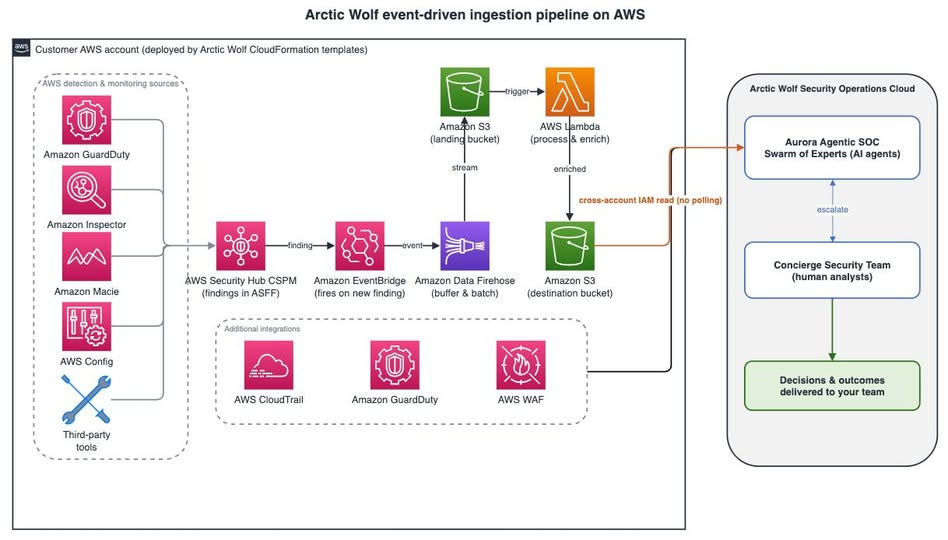

# Giải quyết tín hiệu bảo mật nhanh hơn với Aurora Agentic SOC của Arctic Wolf

Các đội bảo mật thường không thiếu cảnh báo mà thiếu năng lực xử lý. Công cụ phát hiện tạo ra nhiều cảnh báo hơn số người có thể điều tra, và cùng một cảnh báo có thể mang nghĩa khác nhau tùy môi trường: một mẫu dò mật khẩu có thể là kiểm thử xâm nhập ở tài khoản này nhưng là tấn công nhồi thông tin đăng nhập (credential stuffing) ở tài khoản khác. **Amazon GuardDuty** chỉ báo hoạt động API bất thường, không cho biết đó là sự cố thật, cấu hình sai hay kiểm thử hợp lệ.

Bài viết trên AWS Marketplace Blog (có hai tác giả đến từ Arctic Wolf) giới thiệu cách **Arctic Wolf**, có trên AWS Marketplace, kết hợp AI agent với đội ngũ chuyên gia **Concierge Security** để biến các phát hiện trên AWS thành quyết định.

### Các thành phần chính

- **Aurora Agentic SOC:** Trung tâm vận hành an ninh dùng AI agent, thuộc nền tảng Aurora Superintelligence.
- **Swarm of Experts:** Khung agentic gồm các agent chuyên biệt phối hợp để phân loại (triage), điều tra và phản ứng, với chuyên viên con người xác nhận và tiếp nhận các ca cần chuyển lên.
- **Concierge Security Team:** Đội chuyên gia nắm rõ môi trường của khách hàng và phản ứng thay mặt họ.
- **AWS Security Hub CSPM:** Gom phát hiện từ GuardDuty, Inspector, Macie, Config và công cụ bên thứ ba về định dạng **ASFF**.
- **Amazon EventBridge + Amazon Data Firehose + Amazon S3 + AWS Lambda:** Đường ống hướng sự kiện đưa phát hiện về SOC.
- **AWS CloudFormation:** Template do Arctic Wolf cung cấp để dựng toàn bộ đường ống trong tài khoản của khách hàng.

### Đường ống nạp dữ liệu hướng sự kiện

Đường ống nạp dữ liệu đi theo các bước (không dùng polling, phát hiện được đẩy đi ngay khi xuất hiện):

1. **Security Hub CSPM** gom các phát hiện về ASFF.
2. **EventBridge** phát sự kiện khi có phát hiện mới.
3. **Data Firehose** gom và đẩy sự kiện vào S3, kể cả khi lượng tăng đột biến lúc có sự cố.
4. **Lambda** xử lý, làm giàu dữ liệu và chuyển vào bucket đích.
5. **SOC của Arctic Wolf** đọc bucket qua ủy quyền IAM chéo tài khoản, rồi đối chiếu với dữ liệu endpoint, mạng và danh tính trên Aurora.

Ngoài Security Hub, Arctic Wolf còn tích hợp với **AWS CloudTrail**, **GuardDuty** (một tài khoản, nhiều tài khoản qua AWS Organizations hoặc Control Tower) và **AWS WAF**. Theo Arctic Wolf, có hơn 120 quy tắc cảnh báo trên các tích hợp này.

### Phân công giữa AI Agent và Con người

Điểm hay là bài đặt AI agent và con người vào đúng chỗ của mình: agent lo phân loại và điều tra ban đầu ở quy mô lớn, còn chuyên gia con người xử lý các quyết định phức tạp và làm việc với khách hàng. Theo **CloudHesive** (khách hàng được nêu trong bài), kết quả gồm **50% ít cảnh báo cần phân loại hơn**, **điều tra đến khắc phục nhanh hơn 99%** và **tiết kiệm chi phí gấp 10 lần** so với ước tính chi phí tự xây SOC nội bộ.

### Lưu ý từ bài viết

- Bài do nhân sự Arctic Wolf đồng tác giả và kết bằng lời kêu gọi đăng ký, nên các số liệu (hơn 10.000 khách hàng, hơn 10 nghìn tỷ sự kiện mỗi tuần, hơn 14 năm dữ liệu, xếp hạng 4,9/5 trên Gartner Peer Insights) đều là thông tin từ phía nhà cung cấp, chưa có đánh giá độc lập.
- Kết quả của CloudHesive là do chính CloudHesive báo cáo, và mức tiết kiệm gấp 10 lần so với một chi phí ước tính chứ không phải chi phí thực tế.
- Bài nói agent biết khi nào dừng lại và chuyển cho con người, nhưng không mô tả cách agent quyết định điều đó.
- Bài không nêu giá. Arctic Wolf bán qua private offer thương lượng, hiển thị thành một dòng trên hóa đơn AWS hợp nhất. Riêng đường ống tích hợp chạy trong tài khoản của bạn nên bạn trả phí AWS theo mức dùng (có thể ước tính bằng AWS Pricing Calculator).
- Điều kiện tiên quyết: bật AWS Security Hub và Amazon GuardDuty, và có đăng ký Arctic Wolf trên AWS Marketplace.
- Khi gỡ, xóa các stack CloudFormation (bucket S3 còn dữ liệu phải làm trống trước) và báo trước cho đội Concierge vì họ tham gia vận hành. Xóa stack chỉ dừng luồng dữ liệu, không hủy đăng ký Marketplace.

### Nhận xét cá nhân

Mình đọc bài này để hiểu một hướng đi cho vận hành bảo mật: AI agent gánh phần phân loại và điều tra khối lượng lớn, còn quyết định cần hiểu bối cảnh doanh nghiệp vẫn thuộc về con người.

---

**Nguồn:** *Resolve security signals faster with Arctic Wolf’s Aurora Agentic SOC* — Tim Sitze, Dan Jellesma, Kent Whitney, AWS Marketplace Blog (16/10/2026)  
**Liên kết:** https://aws.amazon.com/blogs/awsmarketplace/resolve-security-signals-faster-with-arctic-wolfs-aurora-agentic-soc/  
**Thẻ:** `#AWS` `#FCAJ` `#AWSMarketplace` `#ArcticWolf` `#AgenticSOC` `#AmazonGuardDuty` `#AWSSecurityHub` `#Cybersecurity` `#GenerativeAI` `#AIAgents`
