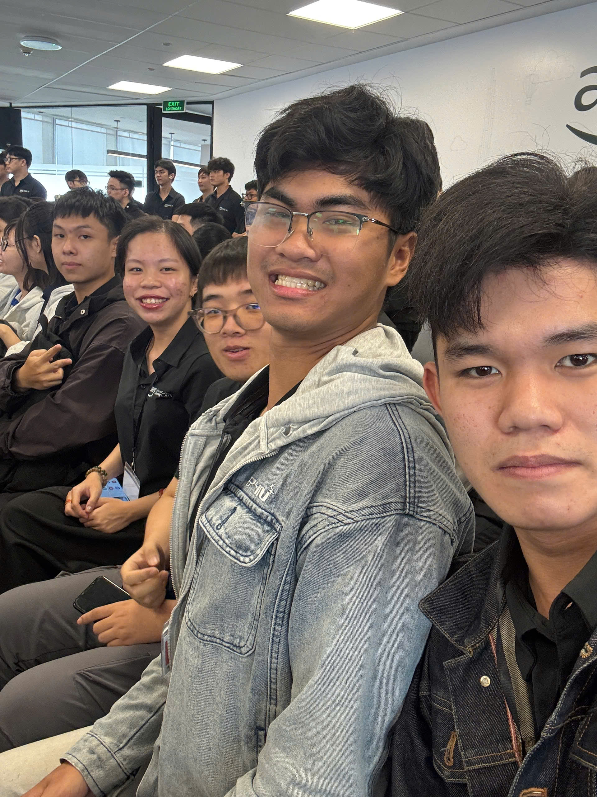

# First Cloud AI Journey: Notes from a Morning of Demos

> **Event:** First Cloud AI Journey  
> **Date:** October 24, 2026 
> **Location:** 26th Floor, Bitexco Financial Tower, Ho Chi Minh City, Vietnam 
> **Role:** Attendee

I attended the First Cloud AI Journey meetup to hear how local engineering teams are moving cloud and AI ideas into working systems. Five short sessions made the morning feel like a tour through different parts of the same problem: making AI useful while keeping the surrounding system secure and manageable.

### Sessions that changed how I think

The Vietnamese Voice AI demonstration made latency tangible. A voice assistant has to listen, interpret, respond, and sound natural within a conversation. A model that is accurate but pauses too long can still feel broken to its user. In the demo, an AI system made a real phone call and conducted an initial Vietnamese-language screening interview for a cloud engineer role. Seeing speech AI handle a live interaction helped me connect model capability with the full user experience.

The two security sessions showed that agents and infrastructure need boundaries before they receive autonomy. One covered cross-account access in AWS Organizations; another described scanning Infrastructure-as-Code during pull requests and testing staging systems with an adversarial user persona. I took away a practical rule: decide what an AI tool is allowed to read or change before connecting it to real resources.

The AgentCore session introduced short-term and long-term memory for production agents. The closing discussion added the operational details: track token use by component, remove stale context, and prevent an agent from taking destructive actions. These details made "agent memory" feel less like a feature and more like a design responsibility.

### What I plan to apply

As an AI student, I used to judge an agent mainly by whether its answer looked good. I now want to judge it by latency, tool permissions, cost per task, and what happens when it makes a mistake. For my own coding assistant, I will start with read-only permissions, keep secrets out of the repository, and add logs before experimenting with automated changes.

The meetup also reminded me to learn from production examples, not only tutorials. My next step is to build a small agent workflow with explicit limits and record its behavior across successful and failed runs. That should teach me more than adding another tool integration without measuring its effect.

---

