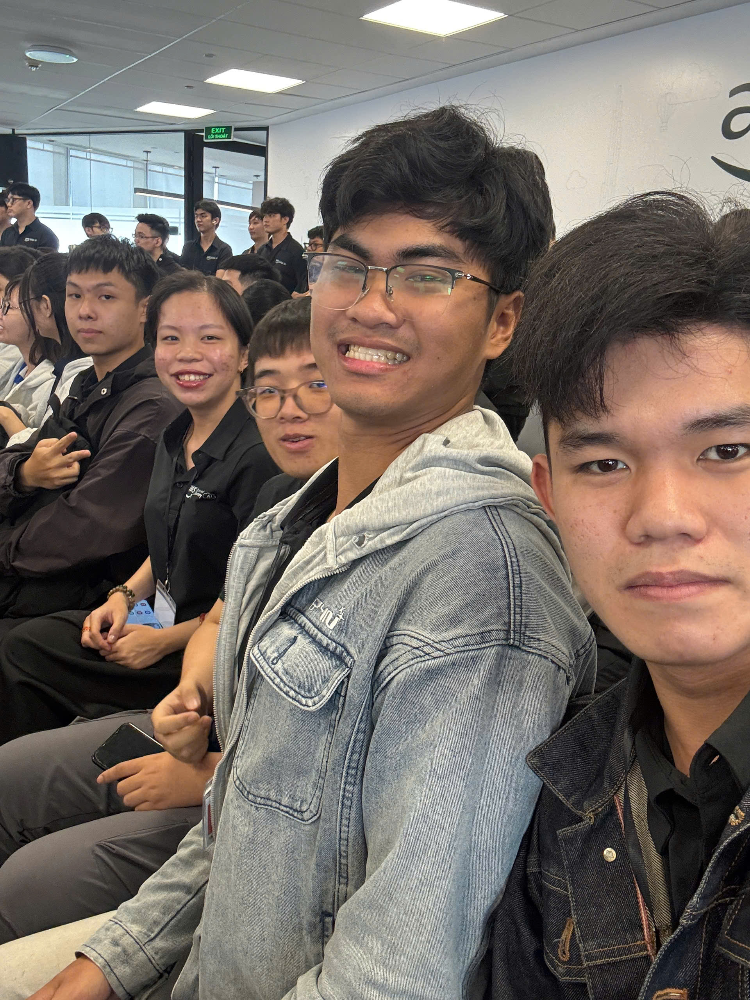

# First Cloud AI Journey: Ghi chú từ một buổi sáng nhiều demo

> **Sự kiện:** First Cloud AI Journey  
> **Ngày:** 24/10/2026 
> **Địa điểm:** Tầng 26, Tòa nhà Bitexco Financial Tower, TP. Hồ Chí Minh, Việt Nam 
> **Vai trò:** Người tham dự

Em tham dự meetup First Cloud AI Journey để nghe các nhóm kỹ thuật trong nước đưa ý tưởng Cloud và AI vào hệ thống chạy thật như thế nào. Năm phiên ngắn trong buổi sáng giống như năm góc nhìn cho cùng một câu hỏi: làm sao để AI hữu ích nhưng vẫn an toàn và dễ kiểm soát.

### Những phiên khiến em suy nghĩ lại

Demo Voice AI tiếng Việt giúp em hình dung rõ độ trễ ảnh hưởng đến trải nghiệm ra sao. Một hệ thống thoại phải nghe, hiểu và phản hồi đủ nhanh để cuộc trò chuyện không bị gượng. Mô hình có thể phân loại đúng nhưng chờ quá lâu vẫn khiến người dùng cảm thấy lỗi. Phần trình diễn cho thấy AI gọi điện thật và thực hiện vòng phỏng vấn sàng lọc ban đầu bằng tiếng Việt cho vị trí cloud engineer. Em thấy rõ năng lực mô hình chỉ là một phần; luồng tương tác hoàn chỉnh mới là thứ người dùng cảm nhận.

Hai phiên về bảo mật cho em thấy agent cần có giới hạn trước khi được giao quyền tự chủ. Một phiên nói về phân quyền giữa các tài khoản trong AWS Organizations; phiên còn lại đề cập việc quét Infrastructure-as-Code ngay trong pull request và dùng persona đối kháng để kiểm tra môi trường staging. Em rút ra một nguyên tắc: phải xác định agent được phép đọc hoặc thay đổi những gì trước khi kết nối nó với tài nguyên thật.

Phần AgentCore giới thiệu cách tách bộ nhớ ngắn hạn và dài hạn. Trong Q&A, các diễn giả nói thêm về việc theo dõi token theo từng thành phần, loại bỏ ngữ cảnh cũ và chặn hành động có thể phá hủy tài nguyên. Em bắt đầu nhìn “memory” của agent như một quyết định kiến trúc cần quản lý, chứ không chỉ là tính năng.

### Điều em muốn áp dụng

Trước đây, em thường đánh giá agent qua câu trả lời có vẻ hợp lý hay không. Sau buổi meetup, em muốn bổ sung latency, quyền công cụ, chi phí mỗi tác vụ và cách hệ thống xử lý khi agent sai vào tiêu chí đánh giá. Với coding assistant cá nhân, em sẽ bắt đầu bằng quyền chỉ đọc, giữ secret ngoài repository và ghi log trước khi thử cho phép công cụ tự thay đổi mã nguồn.

Em cũng muốn học thêm từ ví dụ production thay vì chỉ làm theo tutorial. Bước tiếp theo là xây một workflow agent nhỏ có giới hạn rõ ràng, rồi ghi nhận cả các lần chạy thành công lẫn thất bại để biết từng tích hợp thực sự giúp gì.

---

