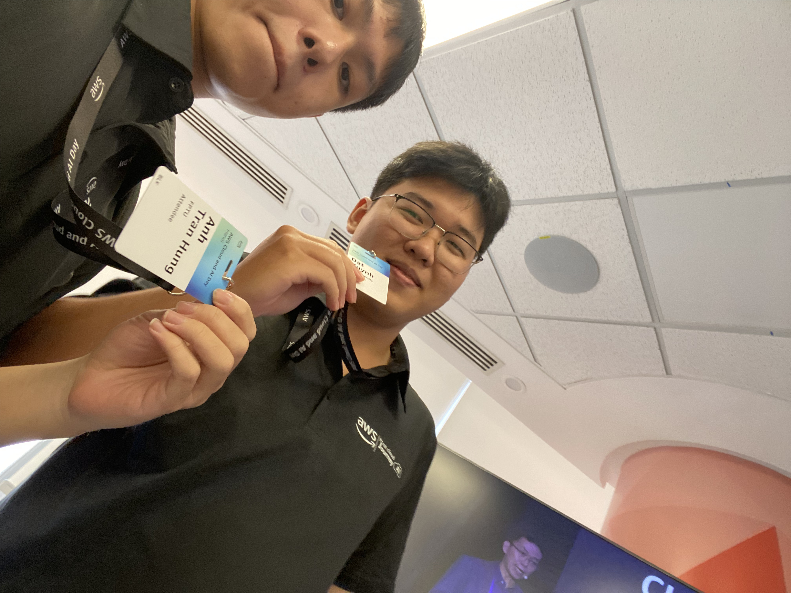

# AWS Cloud & AI Day 2026: Learning Beyond the Livestream

> **Event:** AWS Cloud & AI Day 2026: HCMC Watch Party  
> **Date & Time:** 2026, full-day watch party  
> **Location:** AWS Office, Ho Chi Minh City; hosted by the AWS Study Group community  
> **Role:** Attendee

I joined the HCMC watch party while the main AWS Cloud & AI Day event was taking place in Hanoi. More than 300 builders gathered to watch the sessions and discuss them together. I expected to spend most of the day following the livestream; I ended up learning just as much from the conversations between talks.

### From AI features to AI systems

The keynote connected three topics: agentic systems, data foundations, and cloud modernization. I had previously thought about an AI agent mostly as a model with tools. The discussion made me consider the parts around it: where its data comes from, what permissions it receives, and which existing business process it is meant to improve.

In the smaller roundtables, Solution Architects and developers spoke candidly about moving agents from proof-of-concept to production and managing cloud spend. That shifted my attention from whether an agent can complete a demo task to whether a team can operate it repeatedly, trace its actions, and justify its cost.

### Lessons I am taking into my own work

I want to add three checks to my next AI project: define the data sources and their quality, log the agent's decisions and tool calls, and measure cost alongside task success. If an agent makes a workflow faster but creates hard-to-debug failures or unpredictable usage, the design still needs work.

This also connects with the current AI market. Adoption is broad, but useful deployment depends on dependable systems and clear value, not just adding an AI feature. Stanford HAI's 2026 AI Index describes cost, reliability, and practical value as increasingly important competitive factors. I see those as engineering questions I can test on a small project: compare an AI-assisted workflow with a baseline, count failures, and track cost per completed task. [Stanford HAI, 2026 AI Index](https://hai.stanford.edu/ai-index/2026-ai-index-report).

The most valuable part of attending in person was being able to compare notes with other learners and practitioners. For my next event, I plan to arrive with a concrete question about measuring agent quality and leave with one experiment I can reproduce in my own project.

---

