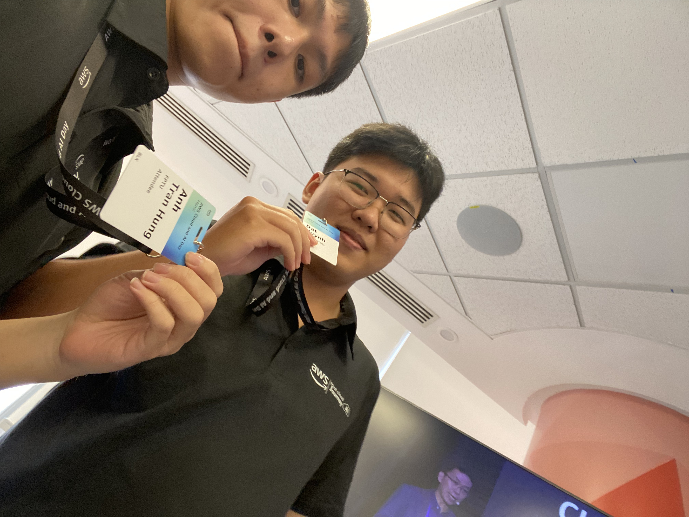

# AWS Cloud & AI Day 2026: Học thêm ngoài buổi livestream

> **Sự kiện:** AWS Cloud & AI Day 2026: HCMC Watch Party  
> **Thời gian:** Cả ngày, 29/09/2026
> **Địa điểm:** Văn phòng AWS tại Thành phố Hồ Chí Minh, do cộng đồng AWS Study Group tổ chức  
> **Vai trò:** Người tham dự

Em tham gia watch party ở TP. Hồ Chí Minh trong lúc sự kiện AWS Cloud & AI Day chính diễn ra tại Hà Nội. Hơn 300 người cùng theo dõi các phiên và trao đổi tại chỗ. Ban đầu em nghĩ mình sẽ chủ yếu xem livestream; thực tế, các cuộc trò chuyện giữa giờ cũng giúp em hiểu vấn đề sâu hơn.

### Từ tính năng AI đến một hệ thống AI

Bài keynote nối ba chủ đề: agentic systems, nền tảng dữ liệu và hiện đại hóa Cloud. Trước đây em thường hình dung AI agent là một mô hình được gắn thêm công cụ. Những trao đổi hôm đó khiến em để ý hơn đến các thành phần xung quanh: dữ liệu agent sử dụng đến từ đâu, agent có quyền gì, và quy trình nào cần được cải thiện.

Trong các phiên bàn tròn, Solution Architects và lập trình viên chia sẻ khá thẳng thắn về việc đưa agent từ proof-of-concept lên production cũng như kiểm soát chi phí Cloud. Em chuyển câu hỏi từ “agent có làm được demo không?” sang “đội ngũ có thể vận hành nó lặp lại, truy vết hành động và giải thích khoản chi đó không?”.

### Bài học em sẽ thử trong dự án

Ở dự án AI tiếp theo, em muốn kiểm tra ba điểm: nguồn dữ liệu và chất lượng dữ liệu, log của quyết định và lần gọi công cụ, cùng chi phí cho mỗi tác vụ. Nếu agent giúp quy trình nhanh hơn nhưng tạo lỗi khó tìm hoặc mức sử dụng khó dự đoán thì thiết kế vẫn cần cải thiện.

Điều này cũng gần với thị trường AI hiện nay. Mức độ ứng dụng đang tăng, nhưng giá trị thực tế phụ thuộc vào hệ thống đáng tin cậy và lợi ích rõ ràng, chứ không chỉ thêm một tính năng AI. Stanford HAI trong AI Index 2026 cũng nhấn mạnh vai trò ngày càng lớn của chi phí, độ tin cậy và tính hữu ích trong cạnh tranh. Em muốn biến nhận định đó thành thử nghiệm nhỏ: so sánh workflow có AI với cách làm ban đầu, đếm lỗi và theo dõi chi phí trên mỗi tác vụ hoàn tất. [Stanford HAI, AI Index 2026](https://hai.stanford.edu/ai-index/2026-ai-index-report).

Phần đáng giá nhất của việc tham dự trực tiếp là được đối chiếu suy nghĩ với người đang học và người đang làm. Ở sự kiện sau, em sẽ chuẩn bị một câu hỏi cụ thể về cách đo chất lượng agent và chọn một thử nghiệm có thể tự tái hiện trong dự án.

---

