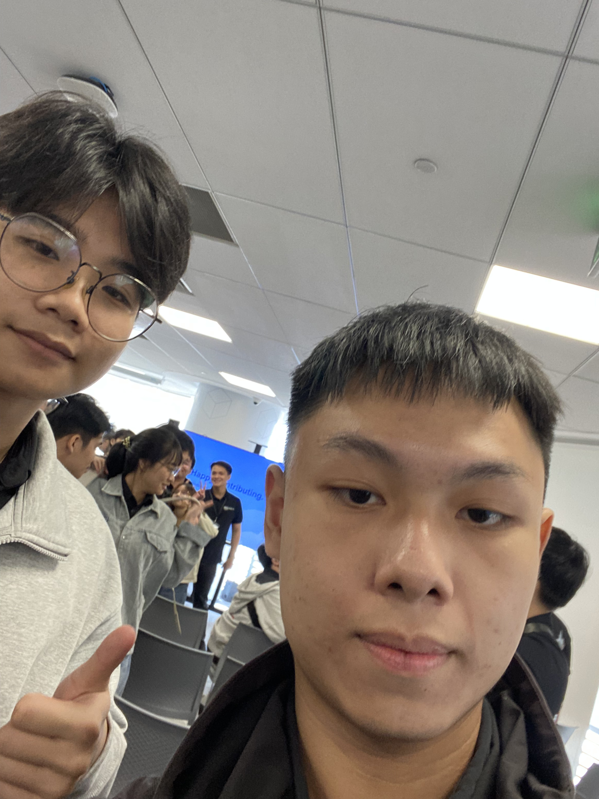

# Engineering in the AI Era: Reflections on Werner Vogels' Keynote

> **Event:** Navigating the Future of Cloud & AI in Vietnam  
> **Speaker:** Dr. Werner Vogels, Amazon CTO  
> **Date:** October 2, 2026
> **Location:** 26th Floor, Bitexco Financial Tower, Ho Chi Minh City, Vietnam 
> **Role:** Attendee

I attended Dr. Werner Vogels' keynote with a question many software students are asking: what should engineers learn as AI becomes part of everyday development? The talk did not frame engineering as a contest between people and AI. Instead, it returned to how teams understand workloads, design for failure, and take responsibility for systems.

### Design from evidence, prepare for failure

Vogels revisited the database pressure Amazon faced during a peak shopping period. The team examined actual request patterns and found that many operations were simple key-value lookups. That understanding helped motivate Dynamo, a design better matched to the workload and an ancestor of DynamoDB. I took this as a reminder to measure the problem before selecting fashionable technology.

He also discussed operational discipline: averages can hide poor experiences at the edge, and components will fail. Resilience therefore needs to be practiced, not assumed. For AI products, I think this applies to model and service failures too. A fallback path, clear error state, and a way to inspect outputs are part of the system, not optional extras.

### My perspective as an AI student

The description of the "Renaissance Developer" emphasized curiosity, systems thinking, ownership, breadth with depth, and communication. Those traits feel relevant as AI tools become common in coding. Generating code is getting easier; checking whether it is correct, safe, maintainable, and appropriate for the workload remains an engineering task.

I plan to review AI-generated code as carefully as code written by a teammate: understand each change, test edge cases, and document assumptions. I also want to map data flow through my projects and ask what happens when a model, API, or dependency fails. The WEF's Future of Jobs Report 2025 lists AI and big data among the fastest-growing skill areas while also highlighting analytical thinking and collaboration. That combination matches what I took from the keynote: technical fluency matters, but judgment and communication determine how responsibly it is applied. [World Economic Forum, Future of Jobs Report 2025](https://www.weforum.org/publications/the-future-of-jobs-report-2025/3-skills-outlook).

I left with a more practical goal than trying to predict which jobs AI will replace: become an engineer who can use AI tools, verify their work, and understand the system those tools help build.

---

