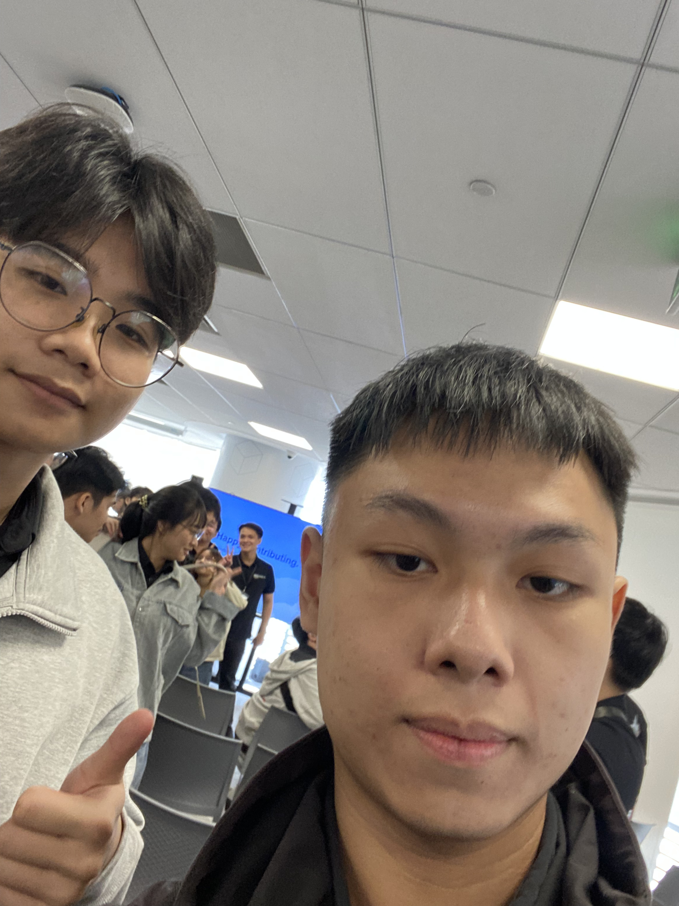

# Kỹ thuật phần mềm trong thời đại AI: Suy nghĩ sau keynote của Werner Vogels

> **Sự kiện:** Navigating the Future of Cloud & AI in Vietnam  
> **Diễn giả:** Tiến sĩ Werner Vogels, CTO của Amazon  
> **Thời gian:** Năm 2026  
> **Địa điểm:** Thành phố Hồ Chí Minh, Việt Nam  
> **Vai trò:** Người tham dự

Em đến nghe keynote của Tiến sĩ Werner Vogels với một câu hỏi mà nhiều sinh viên phần mềm đang quan tâm: cần học gì khi AI ngày càng xuất hiện trong công việc phát triển hằng ngày? Bài nói không đặt con người và AI vào thế cạnh tranh trực tiếp. Diễn giả quay lại những nền tảng quen thuộc nhưng quan trọng: hiểu workload, thiết kế cho tình huống lỗi và chịu trách nhiệm với hệ thống mình xây.

### Thiết kế theo dữ liệu, chuẩn bị cho sự cố

Vogels nhắc lại áp lực mà Amazon từng gặp với cơ sở dữ liệu trong mùa mua sắm cao điểm. Khi xem xét cách hệ thống được sử dụng, đội ngũ nhận ra nhiều truy vấn thực chất chỉ là tra cứu key-value. Hiểu workload cụ thể đã góp phần định hướng thiết kế Dynamo, tiền thân của DynamoDB. Em ghi nhớ rằng trước khi chọn một công nghệ đang thịnh hành, cần biết ứng dụng thực sự phải xử lý kiểu yêu cầu nào.

Ông cũng nói về kỷ luật vận hành: số trung bình có thể che đi trải nghiệm rất tệ của một nhóm người dùng, còn lỗi thì luôn có thể xảy ra. Vì vậy độ bền cần được thử nghiệm, không thể chỉ giả định. Với sản phẩm AI, em nghĩ điều này cũng đúng cho lỗi mô hình hay dịch vụ: cần có trạng thái lỗi dễ hiểu, phương án dự phòng và cách kiểm tra đầu ra.

### Góc nhìn của một sinh viên AI

Hình ảnh “Renaissance Developer” nhấn mạnh sự tò mò, tư duy hệ thống, tinh thần làm chủ, kiến thức rộng đi cùng chuyên môn sâu và giao tiếp. Những phẩm chất này càng cần thiết khi công cụ AI hỗ trợ viết code ngày càng phổ biến. Sinh code có thể nhanh hơn, nhưng kiểm tra tính đúng, an toàn, dễ bảo trì và phù hợp workload vẫn là việc của kỹ sư.

Em sẽ đọc kỹ code do AI tạo như khi review thay đổi của một thành viên nhóm: hiểu từng phần, kiểm thử trường hợp biên và ghi lại giả định. Em cũng muốn vẽ luồng dữ liệu trong dự án để biết chuyện gì xảy ra khi model, API hoặc dependency gặp lỗi. Báo cáo Future of Jobs 2025 của WEF xếp AI và dữ liệu lớn vào nhóm kỹ năng tăng nhu cầu nhanh, đồng thời vẫn đề cao tư duy phân tích và cộng tác. Điều đó khớp với bài học em nhận được: biết dùng công nghệ là cần thiết, nhưng phán đoán và giao tiếp quyết định cách dùng nó có trách nhiệm. [World Economic Forum, Future of Jobs Report 2025](https://www.weforum.org/publications/the-future-of-jobs-report-2025/3-skills-outlook).

Em rời sự kiện với mục tiêu cụ thể hơn việc đoán AI sẽ thay thế nghề nào: trở thành kỹ sư biết tận dụng công cụ AI, kiểm chứng kết quả và hiểu hệ thống mà mình đang xây dựng.

---

