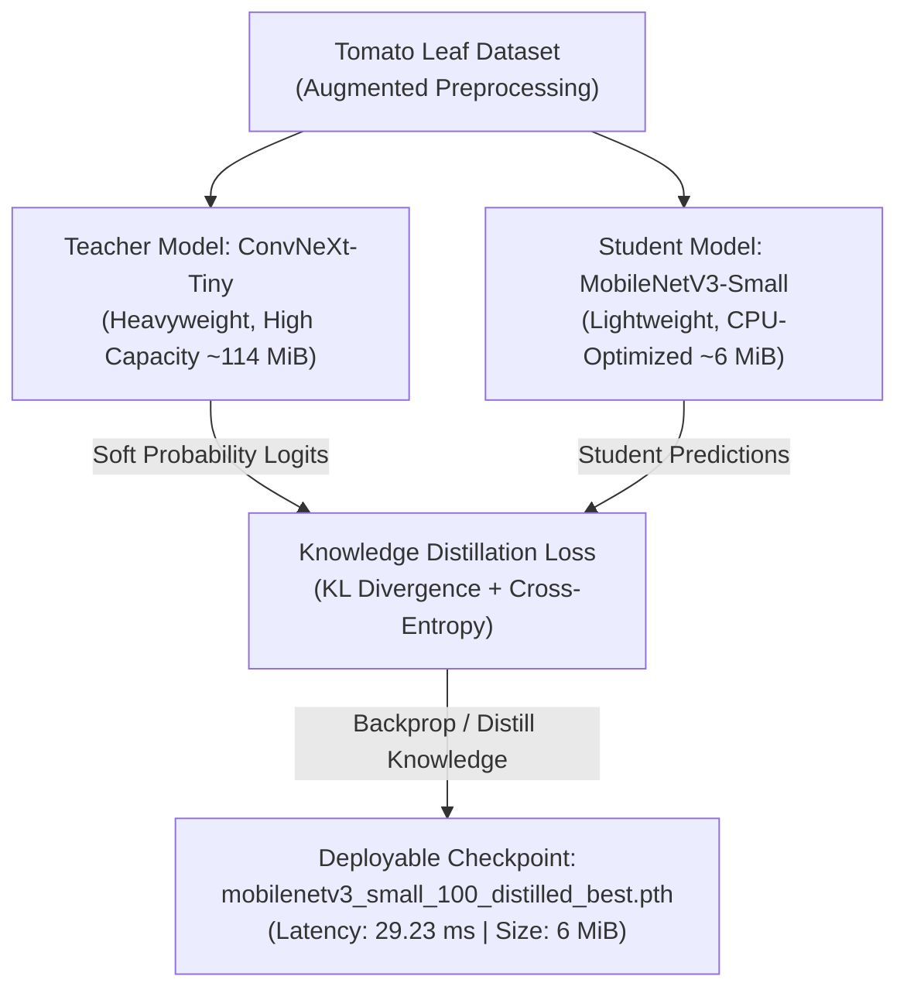

# 5.1 Workshop Overview & Deep Learning System

### Introduction to Plant Disease Detection

The **Plant Disease Detection** system is designed to provide rapid, accurate, and explainable identification of tomato crop diseases from field images. By bridging modern computer vision research with cloud engineering on AWS, the project provides farmers, agronomists, and researchers with an intuitive web application capable of running CPU-efficient deep learning inference in real-time.

The application accepts standard **JPEG** or **PNG** leaf photographs taken from smartphones or cameras, analyzes the visual symptoms using a fine-tuned deep learning model, and outputs ranked disease predictions along with statistical confidence scores.

---

### Classification Scope & Target Classes

The underlying neural network is trained to classify images into **11 distinct output classes**, covering common bacterial, fungal, and viral infections in tomato leaves, as well as healthy controls and out-of-distribution inputs:

| Class ID | Disease / Category Name | Pathogen / Condition | Typical Visual Symptoms |
|---|---|---|---|
| `0` | **Tomato___Bacterial_spot** | *Xanthomonas campestris* | Small, water-soaked, dark spots with yellow halos |
| `1` | **Tomato___Early_blight** | *Alternaria solani* | Concentric target-like dark rings surrounded by chlorosis |
| `2` | **Tomato___Late_blight** | *Phytophthora infestans* | Irregular grayish-green water-soaked lesions on leaves |
| `3` | **Tomato___Leaf_Mold** | *Passalora fulva* | Pale green or yellow spots on upper surface, velvety olive mold below |
| `4` | **Tomato___Septoria_leaf_spot** | *Septoria lycopersici* | Numerous circular spots with gray centers and dark margins |
| `5` | **Tomato___Spider_mites** | *Tetranychus urticae* | Yellow or white stippling, webbing on leaf undersides |
| `6` | **Tomato___Target_Spot** | *Corynespora casiicola* | Brown lesions with prominent concentric rings |
| `7` | **Tomato___Tomato_Yellow_Leaf_Curl_Virus** | Geminivirus (Whitefly-borne) | Upward curling, severe stunting, and bright interveinal chlorosis |
| `8` | **Tomato___Tomato_mosaic_virus** | Tobamovirus | Mottled light and dark green mosaic patterns, leaf distortion |
| `9` | **Tomato___healthy** | Control / Normal | Vigorous green foliage free from chlorosis or necrotic tissue |
| `10` | **unknown** | Out-of-Distribution | Non-tomato foliage, corrupted images, or background noise |

> [!NOTE]
> This system serves as a learning, research, and engineering deployment demonstration; field diagnostic certification must be established prior to commercial agronomic use.

---

### Machine Learning Architecture: Knowledge Distillation

To balance high predictive accuracy with cost-effective cloud hosting on resource-constrained AWS EC2 CPU instances, the research compared several model architectures and adopted **Knowledge Distillation**:

- **Teacher Architecture (ConvNeXt-Tiny):** Modern convolutional network with inverted bottlenecks, large 7x7 receptive fields, and superior feature extraction capabilities.
- **Student Architecture (MobileNetV3-Small):** Hardware-aware network search architecture utilizing hard-swish non-linearities and depthwise separable convolutions, optimized specifically for low-latency CPU execution.
- **Outcome:** The distilled MobileNetV3 model retained over 96% of the teacher's classification capability while reducing model size by over **94%** (down to ~6 MiB) and achieving a lightning-fast single-request CPU inference latency of **29.23 ms**.

---

### Explainable AI (XAI) with Grad-CAM++

A critical requirement in agricultural diagnostics is explainability: agronomists must understand *why* the model made a specific prediction. The application incorporates **Grad-CAM++ (Generalized Gradient-weighted Class Activation Mapping)** to generate heatmaps highlighting the exact pixel regions that contributed most strongly to the predicted disease class.

#### Visual Comparison Across Architectures

The following visualizations illustrate how different model architectures focus on distinct pathological features of the leaf:

| Architecture | Model Role | Heatmap & Overlay Visualization |
|---|---|---|
| **MobileNetV3-Small Distilled** | Production Deployment |  |
| **ConvNeXt-Tiny** | Teacher Baseline |  |
| **EfficientNet-B0** | Candidate Student |  |

---

### Operational Pipeline on AWS

The operational lifecycle connects code repository automation to AWS infrastructure:

1. **Automated Continuous Delivery:** Commits to the `master` branch in GitHub trigger GitHub Actions workflows that execute Python unit tests, Next.js build verification, and build production container images published to **GHCR (GitHub Container Registry)**.
2. **Decoupled Checkpoint Storage:** Model weights (`model.pth`) and class label mappings (`class_to_idx.json`) are maintained in a secure, private **Amazon S3** bucket under the prefix `mobilenet-distilled-v1/`.
3. **Containerized EC2 Host:** A single Amazon Linux 2023 EC2 instance pulls container images and mounts S3 model artifacts read-only into `/app/artifacts`.
4. **Networking & Ingress:** The browser connects to the Next.js frontend on port `3000`, which communicates seamlessly with the FastAPI backend on port `8000`.
5. **Observability:** Container standard output and error streams are captured via the Docker `awslogs` driver into CloudWatch Logs. The **CloudWatch Agent** collects fine-grained host memory and disk utilization, reporting metrics to automated alarm triggers.
