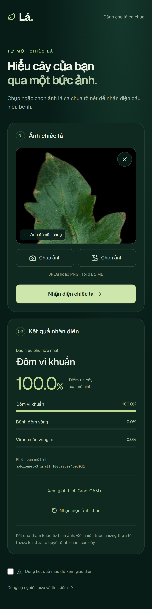
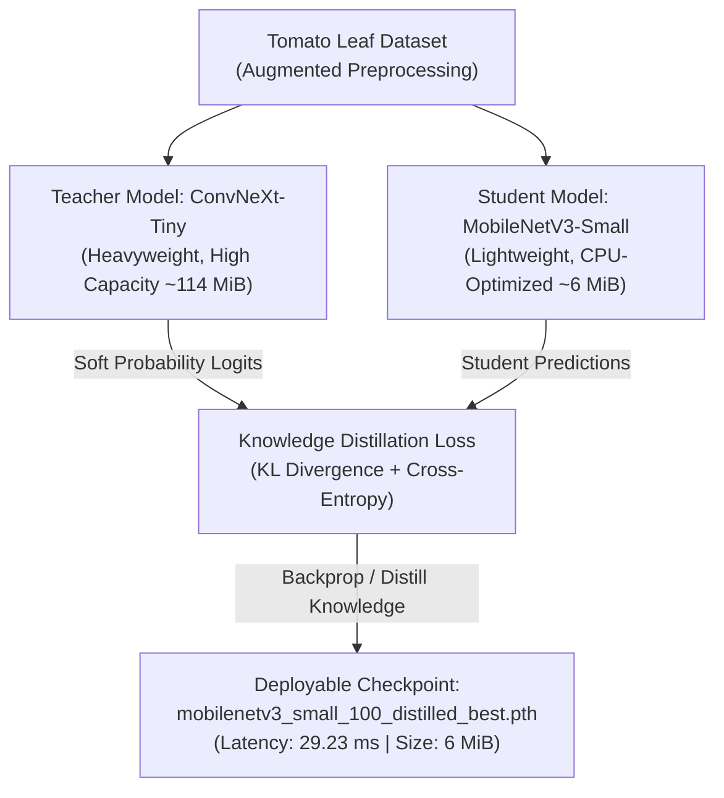
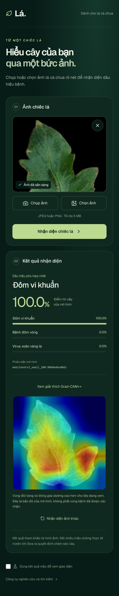
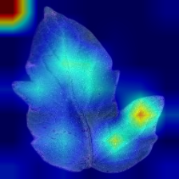
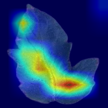
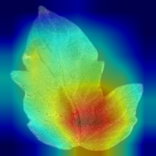

# Introduction

### Introduction to Plant Disease Detection

The **Plant Disease Detection** project is a learning and engineering demonstration of tomato leaf image classification. It connects a CPU-based image classifier to a web interface and a small AWS deployment. It is not validated for field diagnosis and should not be treated as advice for farmers or agronomists.

The application accepts **JPEG** or **PNG** images and returns ranked class predictions with model scores. These scores are not calibrated probabilities, and performance on the small external dataset does not establish reliability on field images.

---

### Classification Scope & Target Classes

The underlying neural network is trained to classify images into **11 distinct output classes**, covering common bacterial, fungal, and viral infections in tomato leaves, as well as healthy controls and out-of-distribution inputs:

| Class ID | Disease / Category Name | Pathogen / Condition | Typical Visual Symptoms |
|---|---|---|---|
| `0` | **Tomato___Bacterial_spot** | *Xanthomonas campestris* | Small, water-soaked, dark spots with yellow halos |
| `1` | **Tomato___Early_blight** | *Alternaria solani* | Concentric target-like dark rings surrounded by chlorosis |
| `2` | **Tomato___Late_blight** | *Phytophthora infestans* | Irregular grayish-green water-soaked lesions on leaves |
| `3` | **Tomato___Leaf_Mold** | *Passalora fulva* | Pale green or yellow spots on upper surface, velvety olive mold below |
| `4` | **Tomato___Septoria_leaf_spot** | *Septoria lycopersici* | Numerous circular spots with gray centers and dark margins |
| `5` | **Tomato___Spider_mites** | *Tetranychus urticae* | Yellow or white stippling, webbing on leaf undersides |
| `6` | **Tomato___Target_Spot** | *Corynespora casiicola* | Brown lesions with prominent concentric rings |
| `7` | **Tomato___Tomato_Yellow_Leaf_Curl_Virus** | Geminivirus (Whitefly-borne) | Upward curling, severe stunting, and bright interveinal chlorosis |
| `8` | **Tomato___Tomato_mosaic_virus** | Tobamovirus | Mottled light and dark green mosaic patterns, leaf distortion |
| `9` | **Tomato___healthy** | Control / Normal | Vigorous green foliage free from chlorosis or necrotic tissue |
| `10` | **unknown** | Out-of-Distribution | Non-tomato foliage, corrupted images, or background noise |

> [!NOTE]
> This is a learning, research, and deployment demonstration. It has not been validated for field diagnosis or commercial agronomic use.

---

### Machine Learning Architecture: Knowledge Distillation

The research compared several model architectures and includes a **Knowledge Distillation** experiment. This technique transfers information from a larger teacher model to a smaller student, but it does not guarantee better predictive performance:

- **Teacher Architecture (ConvNeXt-Tiny):** Modern convolutional network with inverted bottlenecks, large 7x7 receptive fields, and superior feature extraction capabilities.
- **Student Architecture (MobileNetV3-Small):** Hardware-aware network search architecture utilizing hard-swish non-linearities and depthwise separable convolutions, optimized specifically for low-latency CPU execution.
- **Recorded demo model:** The distilled MobileNetV3 checkpoint is approximately **6 MiB**. A single recorded CPU request took **29.23 ms** for model inference; this is not a throughput or end-to-end latency result. Model quality varies across evaluation datasets, so this benchmark does not establish field reliability.

---

### Explainable AI (XAI) with Grad-CAM++

The application includes **Grad-CAM++ (Generalized Gradient-weighted Class Activation Mapping)** as a visual aid for inspecting image regions associated with a prediction. A heatmap is an attribution visualization; it does not identify lesions or confirm a diagnosis.

#### Visual Comparison Across Architectures

The following visualizations illustrate how different model architectures focus on distinct pathological features of the leaf:

| Architecture | Model Role | Heatmap & Overlay Visualization |
|---|---|---|
| **MobileNetV3-Small Distilled** | AWS demo model |  |
| **ConvNeXt-Tiny** | Teacher Baseline |  |
| **EfficientNet-B0** | Candidate Student |  |

---

### Operational Pipeline on AWS

The operational lifecycle connects code repository automation to AWS infrastructure:

1. **CI Build and Manual Release:** Pushes to `master` trigger GitHub Actions to run Python checks, build Next.js and publish container images to **GHCR (GitHub Container Registry)**. An operator deploys or rolls back a release on EC2 manually.
2. **Decoupled Checkpoint Storage:** Model weights (`model.pth`) and class label mappings (`class_to_idx.json`) are maintained in a secure, private **Amazon S3** bucket under the prefix `mobilenet-distilled-v1/`.
3. **Containerized EC2 Host:** A single Amazon Linux 2023 EC2 instance pulls container images and mounts S3 model artifacts read-only into `/app/artifacts`.
4. **Networking & Ingress:** The browser connects to the Next.js frontend on port `3000` and calls the FastAPI backend on port `8000` (`/health`, `/predict`, `/explain`) via the VPC Internet Gateway and Security Group rules restricted to approved source IPs (with `CORS_ORIGINS` configured).
5. **Observability:** Container standard output and error streams are captured via the Docker `awslogs` driver into CloudWatch Logs. The **CloudWatch Agent** collects fine-grained host memory and disk utilization, reporting metrics to automated alarm triggers.
