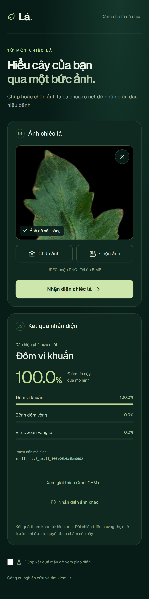
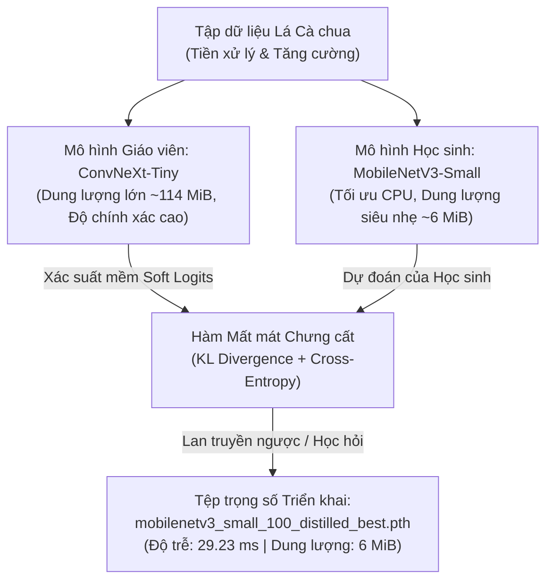
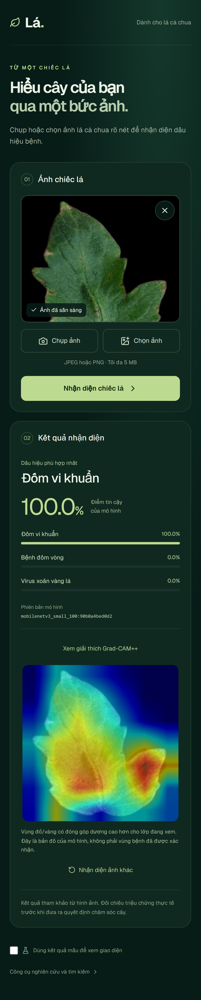
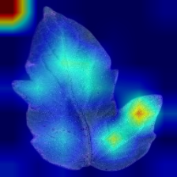
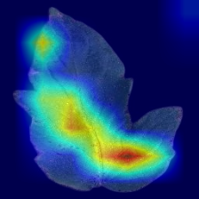
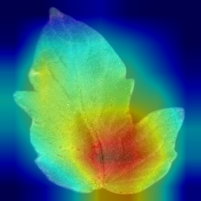

# Giới thiệu

### Giới thiệu Dự án Phân loại Bệnh lá Cây trồng

**Plant Disease Detection** là bản thực hành kỹ thuật về phân loại ảnh lá cà chua. Dự án kết nối bộ phân loại ảnh chạy trên CPU với giao diện web và một môi trường AWS quy mô nhỏ. Hệ thống chưa được kiểm chứng để chẩn đoán ngoài thực địa và không nên được xem là công cụ tư vấn cho nông dân hoặc chuyên gia nông học.

Ứng dụng nhận ảnh **JPEG** hoặc **PNG** và trả về danh sách lớp dự đoán theo thứ hạng cùng điểm số của mô hình. Điểm số này chưa được hiệu chuẩn thành xác suất; kết quả trên tập dữ liệu ngoài nhỏ chưa chứng minh độ tin cậy với ảnh chụp thực địa.

---

### Phạm vi Phân loại & Danh mục 11 Lớp Bệnh

Mạng nơ-ron được huấn luyện để phân loại ảnh vào **11 lớp đầu ra**: các nhóm bệnh do vi khuẩn, nấm, virus trên lá cà chua, lá khỏe mạnh và lớp `unknown`:

| Mã lớp | Tên Phân loại Bệnh | Tác nhân Gây bệnh | Triệu chứng Hình thái Điển hình |
|---|---|---|---|
| `0` | **Tomato___Bacterial_spot** | Vi khuẩn *Xanthomonas campestris* | Các đốm nhỏ ngậm nước, chuyển nâu đen có quầng vàng bao quanh |
| `1` | **Tomato___Early_blight** | Nấm *Alternaria solani* | Các vòng tròn đồng tâm màu nâu sẫm như tâm bia, có quầng úa vàng |
| `2` | **Tomato___Late_blight** | Nấm *Phytophthora infestans* | Vết bệnh hình dạng bất định màu xanh xám ngậm nước trên bề mặt lá |
| `3` | **Tomato___Leaf_Mold** | Nấm *Passalora fulva* | Đốm vàng nhạt ở mặt trên, lớp mốc nhung màu ô-liu sẫm ở mặt dưới lá |
| `4` | **Tomato___Septoria_leaf_spot** | Nấm *Septoria lycopersici* | Nhiều đốm nhỏ hình tròn viền sẫm, tâm xám tro xuất hiện rải rác |
| `5` | **Tomato___Spider_mites** | Nhện đỏ *Tetranychus urticae* | Đốm châm kim màu vàng li ti, xuất hiện tơ nhện mỏng mặt dưới |
| `6` | **Tomato___Target_Spot** | Nấm *Corynespora casiicola* | Đốm nâu hình tròn hoặc góc cạnh có các vân đồng tâm nổi bật |
| `7` | **Tomato___Tomato_Yellow_Leaf_Curl_Virus** | Geminivirus (Bọ phấn trắng truyền) | Rìa lá cong vồng lên, phiến lá thu nhỏ, vàng úa giữa các gân |
| `8` | **Tomato___Tomato_mosaic_virus** | Tobamovirus | Phiến lá loang lổ xen kẽ các mảng xanh đậm nhạt, lá biến dạng |
| `9` | **Tomato___healthy** | Lá Khỏe mạnh (Đối chứng) | Lá xanh mướt, phát triển bình thường, không có vết hoại tử |
| `10` | **unknown** | Mẫu Ngoài Phân bố (OOD) | Ảnh không phải lá cà chua, ảnh mờ nhiễu hoặc phông nền không xác định |

> [!NOTE]
> Đây là bản demo phục vụ học tập, nghiên cứu và thực hành triển khai. Hệ thống chưa được xác minh cho chẩn đoán thực địa hoặc mục đích thương mại trong nông nghiệp.

---

### Kiến trúc Trí tuệ Nhân tạo: Chưng cất Tri thức (Knowledge Distillation)

Nghiên cứu có thử nghiệm **Chưng cất Tri thức (Knowledge Distillation)**, kỹ thuật truyền thông tin từ mô hình giáo viên lớn sang mô hình học sinh nhỏ hơn. Kỹ thuật này không bảo đảm mô hình học sinh sẽ đạt kết quả dự đoán tốt hơn:

- **Mô hình Giáo viên (ConvNeXt-Tiny):** Kiến trúc tích chập hiện đại với các khối inverted bottleneck và trường tiếp nhận lớn 7x7, cung cấp khả năng trích xuất đặc trưng sâu sắc.
- **Mô hình Học sinh (MobileNetV3-Small):** Được tối ưu hóa bằng thuật toán tìm kiếm kiến trúc phần cứng, sử dụng depthwise separable convolutions và hàm kích hoạt hard-swish, cực kỳ tối ưu cho CPU.
- **Mô hình dùng trong demo:** Checkpoint MobileNetV3 chưng cất có dung lượng khoảng **6 MiB**. Một lần đo suy luận CPU được ghi nhận là **29,23 ms**; đây không phải kết quả throughput hay độ trễ đầu-cuối. Chất lượng mô hình thay đổi giữa các tập đánh giá, vì vậy số đo này không chứng minh độ tin cậy khi dùng ngoài thực địa.

---

### Khả năng Giải thích Quyết định với Grad-CAM++

Ứng dụng có **Grad-CAM++** để trực quan hóa các vùng ảnh liên quan đến dự đoán. Bản đồ nhiệt chỉ hỗ trợ quan sát cách mô hình phản hồi; nó không phân đoạn tổn thương hay xác nhận chẩn đoán.

#### So sánh Biểu đồ Nhiệt giữa các Kiến trúc

Bảng sau đây thể hiện cách các kiến trúc mạng khác nhau tập trung vào tổn thương bệnh học trên lá:

| Kiến trúc | Vai trò | Hình ảnh Trực quan hóa Lớp Phủ (Overlay) |
|---|---|---|
| **MobileNetV3-Small Chưng cất** | Mô hình dùng trong demo AWS |  |
| **ConvNeXt-Tiny** | Mô hình Giáo viên |  |
| **EfficientNet-B0** | Mô hình Ứng viên |  |

---

### Luồng Vận hành Tổng thể trên AWS

Chu trình vận hành kết nối liền mạch từ kho mã nguồn đến hạ tầng đám mây AWS:

1. **Tự động hóa CI/CD:** Các commit trên nhánh `master` kích hoạt GitHub Actions chạy kiểm thử mã nguồn Python, build giao diện Next.js và đóng gói container image đẩy lên **GHCR (GitHub Container Registry)**.
2. **Lưu trữ Tách rời Trọng số:** Tệp mô hình (`model.pth`) và ánh xạ phân lớp (`class_to_idx.json`) được lưu trữ tại **Amazon S3** bảo mật dưới tiền tố `mobilenet-distilled-v1/`.
3. **Máy chủ EC2 Chạy Container:** Máy chủ Amazon Linux 2023 kéo images từ GHCR và gắn ổ đĩa S3 chỉ đọc (read-only) vào thư mục `/app/artifacts`.
4. **Mạng & Cổng Giao tiếp:** Trình duyệt kết nối tới giao diện Next.js tại cổng `3000` và gọi API FastAPI tại cổng `8000` (`/health`, `/predict`, `/explain`) qua Internet Gateway và Security Group giới hạn theo các IP nguồn được phê duyệt (kèm cấu hình `CORS_ORIGINS`).
5. **Khả năng Quan sát:** Nhật ký stdout/stderr được chuyển về CloudWatch Logs bằng Docker `awslogs` driver. **CloudWatch Agent** đo đạc chỉ số RAM và đĩa định kỳ 60 giây để kích hoạt cảnh báo email tự động.
