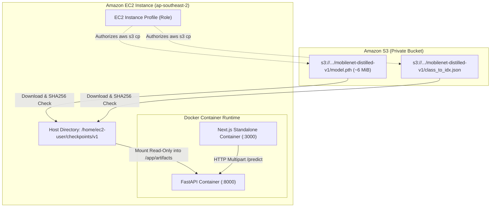

# Architecture & Design

### Architectural Principles: Decoupled Weights from Code

In standard machine learning operations (MLOps), embedding binary model checkpoints directly into Docker images causes significant operational friction: container images inflate in size, build and push times slow down, and changing a model version forces a complete container rebuild.

The **Plant Disease Detection** architecture cleanly decouples the code runtime from the model artifacts:
1. **Container Image:** Contains only the application logic, dependencies (FastAPI, PyTorch CPU, Next.js), and static assets, keeping the base image compact.
2. **Model Storage in Amazon S3:** The PyTorch checkpoint (`model.pth`) and label index dictionary (`class_to_idx.json`) reside in a private S3 bucket.
3. **Runtime Ingestion:** During deployment, the EC2 host downloads the target release artifacts using IAM credentials, validates their cryptographic integrity, and mounts them as a **read-only volume** (`/app/artifacts`) into the inference container.



---

### 5.3.1 Prepare Identity and Artifact Permissions

Before initiating file downloads, verify that the EC2 instance has successfully assumed the IAM role and can interact with the S3 regional endpoint:

```bash
# Verify instance profile credentials
aws sts get-caller-identity

# Configure working environment
export AWS_DEFAULT_REGION="ap-southeast-2"
read -r -p "Enter S3 bucket name: " MODEL_BUCKET

# Create host directory for model artifacts
mkdir -p checkpoints/v1
```

> [!NOTE]
> The current deployment utilizes S3 regional service endpoints accessed via the public subnet's default route table to the Internet Gateway. In enterprise production environments with private VPC subnets, an **Amazon S3 Gateway VPC Endpoint** can be provisioned to route traffic entirely over AWS private network backbones at zero data transfer cost.

---

### 5.3.2 Download and Validate Artifacts

Execute the following commands to download the release checkpoint and class mapping from Amazon S3, followed by an immediate cryptographic hash verification:

```bash
# Download model weights and class index
aws s3 cp "s3://$MODEL_BUCKET/mobilenet-distilled-v1/model.pth" checkpoints/v1/model.pth
aws s3 cp "s3://$MODEL_BUCKET/mobilenet-distilled-v1/class_to_idx.json" checkpoints/v1/class_to_idx.json

# Verify SHA256 checksums
sha256sum checkpoints/v1/model.pth checkpoints/v1/class_to_idx.json
```

#### Recorded Verification Hashes

The downloaded files must match the exact cryptographic digests generated during the offline model training and validation audit:

| Artifact File | Expected SHA256 Checksum | Approximate Size | Verification Status |
|---|---|---|---|
| `model.pth` | `05e72798a74193499f17c4c8267c1436e8bc65cc1e8b8037245664a17644efa5` | `~6.0 MiB` | **MATCHED** |
| `class_to_idx.json` | `ff5c73e7a7e3e495593fa664b75ebc73de4c9a425f1d847351ae60bc1fbaa786` | `~1.2 KiB` | **MATCHED** |

> [!IMPORTANT]
> A mismatch in SHA256 indicates either an incomplete download, an outdated release artifact, or potential tampering. The FastAPI backend refuses to serve traffic and returns an explicit 503 Service Unavailable if weights fail integrity checks.

---

### Model Artifact Explainability Comparison

The distilled MobileNetV3-Small weights preserve high fidelity to the ConvNeXt-Tiny teacher while significantly reducing parameter count:

| Teacher Model (ConvNeXt-Tiny) | Student Model (MobileNetV3-Small Distilled) |
|---|---|
|  |  |
| Broad receptive field capturing overall leaf morphology | Concentrated gradient heatmaps targeting necrotic lesion margins |
