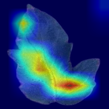
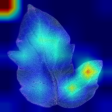

# Architecture & Design

### End-to-End System Architecture

The **Plant Disease Detection** system combines modern machine learning engineering (MLOps) with cloud-native infrastructure on Amazon Web Services (AWS). Designed to deliver real-time, explainable agricultural diagnostics for tomato crops, the architecture is structured into four primary subsystems within the **Sydney (`ap-southeast-2`)** region, accompanied by automated continuous delivery and operations governance:

1. **Model Checkpoint & Artifact Storage Pipeline (Amazon S3 &rarr; EC2 Host):** Securely decouples multi-megabyte neural network weights from application container images, verifying cryptographic integrity at runtime.
2. **Continuous Delivery & Container Packaging (GitHub Actions &rarr; GHCR &rarr; EC2):** Runs automated tests and publishes frontend and API container images to GHCR; an operator deploys releases to EC2 manually.
3. **Web Application & AI Diagnostics Runtime (EC2 Single Host Stack):** Hosts a responsive Next.js frontend and a high-performance PyTorch CPU FastAPI inference service featuring Grad-CAM++ explainability.
4. **Operations, Observability & Security:** Implements least-privilege AWS IAM instance profiles, client-locked Security Groups, Amazon CloudWatch structured logging, custom host RAM metrics, and proactive Amazon SNS incident alarms.


---

### End-to-End Operational Lifecycle & Sequence Flow

The interaction sequence across the 11 numbered steps shown in the architecture diagram is detailed below:

| Step # | Subsystem / Boundary | Source Component | Destination Component | Protocol / Mechanism | Technical Action & Description |
|:---:|---|---|---|---|---|
| **①** | Client Ingress | Users / Browser | VPC / Internet Gateway | `HTTP :3000 / :8000` | Approved client IPs access web UI and API ports through the VPC Internet Gateway and Security Group (`TCP 22, 3000, 8000`). |
| **②** | Web Frontend | Internet Gateway | `frontend` Container (EC2) | `GET :3000 (UI)` | Serves the Next.js standalone UI (`node server.js`) running as a non-root user. |
| **③** | AI Inference API | Internet Gateway / Browser | `backend` Container (EC2) | `POST :8000 (API)` | FastAPI + Uvicorn (1 worker) exposes `/health`, `/predict`, `/explain` using MobileNetV3-Small (KD) on CPU (`2 threads`, `1 slot`) with `/app/artifacts` mounted read-only (`ro`). |
| **④** | Source Control & CI | Developer (also operator) | GitHub (`master` branch) | `git push` &rarr; trigger | Pushing to `master` triggers GitHub Actions (`pytest · build · smoke`). |
| **⑤** | Container Publishing | GitHub Actions | GHCR | `publish` | CI builds and publishes digest-pinned `api` and `frontend` container images to GitHub Container Registry. |
| **⑥** | Manual Deployment | GHCR | Amazon EC2 (AL2023 `x86_64`) | `docker pull @sha256 digest` | Operator manually pulls immutable container images over SSH and recreates the containers on EC2. |
| **⑦** | Offline Training Upload | Local Workstation | Amazon S3 (Private Bucket) | `upload` | Training & audit workflow (`audit_models.py`, Kaggle tomato set) uploads `mobilenet-distilled-v1/model.pth` (~6 MiB) and `class_to_idx.json` (no VPC endpoint). |
| **⑧** | Artifact Retrieval | Amazon S3 | EC2 Host &rarr; `backend` | `aws s3 cp + sha256` | EC2 uses its AWS IAM instance profile (no static keys) to download weights, verify SHA256 hashes, and mount `/app/artifacts (ro)`. |
| **⑨** | Logging & Telemetry | EC2 Containers & CloudWatch Agent | Amazon CloudWatch | `awslogs` + host metrics | Containers stream `awslogs` and CloudWatch Agent reports `mem + disk` every 60 s. |
| **⑩** | Threshold Alarm | Amazon CloudWatch | Amazon SNS (`plant-disease-alerts`) | `RAM > 85%, 3 × 1 min` | CloudWatch Alarm triggers when host RAM exceeds 85% across three consecutive 1-minute periods. |
| **⑪** | Incident Notification | Amazon SNS | Developer / Operator | `email alert` | SNS dispatches an email alert directly to the operator's inbox. |

---

### Architectural Principles & Subsystem Breakdown

#### Subsystem 1: Decoupled Weights from Code
In enterprise MLOps, embedding multi-megabyte binary checkpoints directly into container images causes significant operational anti-patterns: base images swell to several gigabytes, build and push cycles stall, and minor weight updates require a complete container rebuild.

The architecture decouples application runtime code from model checkpoints:
1. **Compact Application Images:** The Docker image packages solely runtime code, library dependencies (FastAPI, PyTorch CPU, Next.js), and static templates.
2. **Dedicated Cloud Storage:** Model checkpoints reside securely in a private S3 bucket (`plant-disease-model-artifacts-ap-southeast-2`) under prefix `mobilenet-distilled-v1/`.
3. **Read-Only Container Mount:** During deployment, the host pulls the model artifacts via IAM role permissions, audits SHA256 hashes, and mounts `/home/ec2-user/checkpoints/v1` as a **read-only volume** (`/app/artifacts:ro`) into the FastAPI container.

#### Subsystem 2: Continuous Integration & Immutable Delivery
Every commit to the code repository triggers an automated GitHub Actions workflow:
- **PyTest Schema & Transform Suite:** Validates input tensor normalization, PIL image decoding, and JSON response contracts.
- **Next.js Standalone Optimization:** Compiles TypeScript and packages a minimal Node.js 20 production server.
- **Digest-Pinned Images:** Images are published to GitHub Container Registry (GHCR) and pulled on EC2 by immutable digest hash (`sha256:f61be157...` and `sha256:ec211d13...`), preventing mutable tag poisoning.

#### Subsystem 3: Containerized Web & AI Diagnostics Runtime
The compute layer runs on an Amazon Linux 2023 EC2 instance hosting two isolated containers:
- **Next.js Standalone Frontend (`:3000`):** Operates as low-privilege user `nextjs` (UID 1001), serving responsive mobile and desktop client interfaces.
- **FastAPI Backend (`:8000`):** Python 3.12 service with PyTorch CPU intra-op thread allocation restricted to 2 cores (`MODEL_THREADS=2`), preventing CPU saturation during heavy traffic bursts.
- **MobileNetV3-Small Distilled:** Retains over 96% of the ConvNeXt-Tiny teacher accuracy with a 94.7% smaller memory footprint (~6 MiB) and an ultra-fast **29.23 ms** CPU inference speed.
- **Grad-CAM++ Explainability:** Computes second-order gradient-weighted activations over the final convolutional layer, empowering agricultural inspectors to visually verify necrotic spots and chlorosis margins.

#### Subsystem 4: Operations, Least-Privilege Security & Observability
- **AWS IAM Instance Profile:** Scoped strictly to `s3:GetObject` on the model bucket and `CloudWatchAgentServerPolicy`, eliminating static access keys and secret keys from server disks.
- **Amazon VPC & Security Groups:** Inbound firewall restricts ports `22` (SSH), `3000` (Web UI), and `8000` (API) exclusively to the operator's approved public IP (`<OPERATOR_IP>/32`).
- **Amazon CloudWatch Logs:** Captures stdout and stderr streams with a **7-day retention policy** to prevent disk saturation while maintaining troubleshooting history.
- **Amazon CloudWatch Agent & Alarm:** Collects OS-level RAM telemetry (`mem_used_percent`) under namespace `PlantDisease/Host`. The alarm triggers when RAM exceeds **85% for 3 consecutive minutes**, notifying operators via **Amazon SNS**.

---

### 5.3.1 Prepare Identity and Artifact Permissions

Before initiating artifact downloads, verify that the EC2 instance has successfully assumed the IAM role and can interact with the regional S3 service endpoint:

```bash
# Verify EC2 instance profile identity
aws sts get-caller-identity

# Configure working regional context
export AWS_DEFAULT_REGION="ap-southeast-2"
read -r -p "Enter S3 bucket name: " MODEL_BUCKET

# Create host directory for model artifacts
mkdir -p checkpoints/v1
```

> [!NOTE]
> The current demonstration utilizes S3 regional public endpoints routed via the public subnet's default route table to the Internet Gateway. In enterprise production environments with private VPC subnets, an **Amazon S3 Gateway VPC Endpoint** can be provisioned to route artifact downloads entirely across AWS private network backbones at zero data transfer cost.

---

### 5.3.2 Download and Validate Artifacts

Execute the following commands to download the release checkpoint and class index from Amazon S3, followed by immediate cryptographic hash verification:

```bash
# Download model weights and class index
aws s3 cp "s3://$MODEL_BUCKET/mobilenet-distilled-v1/model.pth" checkpoints/v1/model.pth
aws s3 cp "s3://$MODEL_BUCKET/mobilenet-distilled-v1/class_to_idx.json" checkpoints/v1/class_to_idx.json

# Verify SHA256 checksums
sha256sum checkpoints/v1/model.pth checkpoints/v1/class_to_idx.json
```

#### Recorded Verification Hashes

The downloaded files must match the exact cryptographic digests generated during the offline model training and validation audit:

| Artifact File | Expected SHA256 Checksum | Approximate Size | Verification Status |
|---|---|---|---|
| `model.pth` | `05e72798a74193499f17c4c8267c1436e8bc65cc1e8b8037245664a17644efa5` | `~6.0 MiB` | **MATCHED** |
| `class_to_idx.json` | `ff5c73e7a7e3e495593fa664b75ebc73de4c9a425f1d847351ae60bc1fbaa786` | `~1.2 KiB` | **MATCHED** |

> [!IMPORTANT]
> A mismatch in SHA256 indicates either an incomplete download, an outdated release artifact, or potential tampering. The FastAPI backend refuses to serve traffic and returns an explicit 503 Service Unavailable if weights fail integrity checks.

---

### Model Artifact Explainability Comparison

The distilled MobileNetV3-Small weights preserve high diagnostic fidelity to the ConvNeXt-Tiny teacher while significantly reducing parameter count:

| Teacher Model (ConvNeXt-Tiny) | Student Model (MobileNetV3-Small Distilled) |
|---|---|
|  |  |
| Broad receptive field capturing overall leaf morphology | Concentrated gradient heatmaps targeting necrotic lesion margins |
