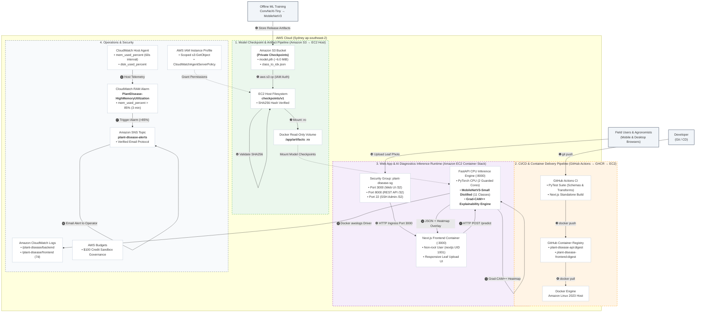

# Architecture & Design

### End-to-End System Architecture

The **Plant Disease Detection** system combines modern machine learning engineering (MLOps) with cloud-native infrastructure on Amazon Web Services (AWS). Designed to deliver real-time, explainable agricultural diagnostics for tomato crops, the architecture is structured into four primary subsystems within the **Sydney (`ap-southeast-2`)** region, accompanied by automated continuous delivery and operations governance:

1. **Model Checkpoint & Artifact Storage Pipeline (Amazon S3 &rarr; EC2 Host):** Securely decouples multi-megabyte neural network weights from application container images, verifying cryptographic integrity at runtime.
2. **Continuous Delivery & Container Packaging (GitHub Actions &rarr; GHCR &rarr; EC2):** Automatically tests, packages, and promotes immutable, digest-pinned multi-stage container images.
3. **Web Application & AI Diagnostics Runtime (EC2 Single Host Stack):** Hosts a responsive Next.js frontend and a high-performance PyTorch CPU FastAPI inference service featuring Grad-CAM++ explainability.
4. **Operations, Observability & Security:** Implements least-privilege AWS IAM instance profiles, client-locked Security Groups, Amazon CloudWatch structured logging, custom host RAM metrics, and proactive Amazon SNS incident alarms.




---

### End-to-End Operational Lifecycle & Sequence Flow

The interaction sequence across the 18 numbered steps shown in the architecture diagram is detailed below:

| Step # | Subsystem / Boundary | Source Component | Destination Component | Protocol / Mechanism | Technical Action & Description |
|:---:|---|---|---|---|---|
| **❶** | Source Control | Developer | GitHub Repository | `git push` | Developer commits tested code and configurations to `master` branch. |
| **❷** | Continuous Integration | GitHub Repository | GitHub Actions | Webhook Trigger | Repository push activates automated CI pipeline defined in `.github/workflows/ci.yml`. |
| **❸** | Container Publishing | GitHub Actions | GitHub Container Registry (GHCR) | `docker push` | CI builds multi-stage production images and publishes digest-pinned artifacts. |
| **❹** | Artifact Storage | Offline Training Pipeline | Amazon S3 Bucket | HTTPS S3 Upload | Offline knowledge distillation exports release `model.pth` and `class_to_idx.json`. |
| **❺** | Artifact Retrieval | Amazon S3 Bucket | EC2 Host Directory | `aws s3 cp` | EC2 host downloads release artifacts authorized via IAM instance profile credentials. |
| **❻** | Integrity Audit | EC2 Host Filesystem | Host Verification Script | `sha256sum` | Host validates cryptographic SHA256 checksums against the immutable audit manifest. |
| **❼** | Container Isolation | EC2 Host Directory | FastAPI Container | Docker `:ro` Volume | Host mounts `checkpoints/v1` read-only to `/app/artifacts` preventing checkpoint corruption. |
| **❽** | Image Delivery | GHCR | Docker Engine (EC2) | `docker pull` | EC2 host pulls immutable container images by digest hash (`sha256:...`). |
| **❾** | User Ingress | Farmers & Agronomists | Amazon VPC Security Group | HTTP (`:3000`) | External client accesses Next.js web application through locked security group ingress. |
| **❿** | Image Submission | Client Browser | Next.js Frontend | HTTP Multipart | User uploads tomato leaf photo (`tomato-leaf.jpg`) via interactive web interface. |
| **⓫** | Inference Dispatch | Next.js Frontend | FastAPI Backend Container | HTTP POST (`:8000`) | Frontend proxies diagnostic request to `/predict` on the private container port. |
| **⓬** | Neural Classification | FastAPI Inference Engine | MobileNetV3-Small Runtime | PyTorch CPU (2 Threads) | Model performs 11-class single-forward pass inference in **29.23 ms** CPU latency. |
| **⓭** | Explainability Mapping | PyTorch Backend | Grad-CAM++ Engine | Gradient Feature Maps | Generates pixel activation heatmaps highlighting necrotic lesion boundaries. |
| **⓮** | Diagnostic Payload | FastAPI Backend | Next.js Web UI | JSON + PNG Overlay | Returns ranked classification probabilities and transparent explainability heatmap. |
| **⓯** | Container Logging | Docker Engine | Amazon CloudWatch Logs | Docker `awslogs` Driver | Streams structured JSON access logs to `/plant-disease/backend` and `/plant-disease/frontend`. |
| **⓰** | Telemetry Sampling | CloudWatch Agent | CloudWatch Metrics | Custom Metric Emission | Host daemon collects OS memory (`mem_used_percent`) and disk metrics every 60s. |
| **⓱** | Threshold Evaluation | CloudWatch Metrics | CloudWatch Alarm | Metric Threshold Breach | Alarm triggers when average host memory exceeds 85% for 3 consecutive minutes. |
| **⓲** | Incident Notification | CloudWatch Alarm | Amazon SNS Topic | Email Subscription Protocol | SNS immediately delivers high-priority memory saturation notification to operator inbox. |

---

### Architectural Principles & Subsystem Breakdown

#### Subsystem 1: Decoupled Weights from Code
In enterprise MLOps, embedding multi-megabyte binary checkpoints directly into container images causes significant operational anti-patterns: base images swell to several gigabytes, build and push cycles stall, and minor weight updates require a complete container rebuild.

The architecture decouples application runtime code from model checkpoints:
1. **Compact Application Images:** The Docker image packages solely runtime code, library dependencies (FastAPI, PyTorch CPU, Next.js), and static templates.
2. **Dedicated Cloud Storage:** Model checkpoints reside securely in a private S3 bucket (`plant-disease-model-artifacts-ap-southeast-2`) under prefix `mobilenet-distilled-v1/`.
3. **Read-Only Container Mount:** During deployment, the host pulls the model artifacts via IAM role permissions, audits SHA256 hashes, and mounts `/home/ec2-user/checkpoints/v1` as a **read-only volume** (`/app/artifacts:ro`) into the FastAPI container.

#### Subsystem 2: Continuous Integration & Immutable Delivery
Every commit to the code repository triggers an automated GitHub Actions workflow:
- **PyTest Schema & Transform Suite:** Validates input tensor normalization, PIL image decoding, and JSON response contracts.
- **Next.js Standalone Optimization:** Compiles TypeScript and packages a minimal Node.js 20 production server.
- **Digest-Pinned Images:** Images are published to GitHub Container Registry (GHCR) and pulled on EC2 by immutable digest hash (`sha256:f61be157...` and `sha256:ec211d13...`), preventing mutable tag poisoning.

#### Subsystem 3: Containerized Web & AI Diagnostics Runtime
The compute layer runs on an Amazon Linux 2023 EC2 instance hosting two isolated containers:
- **Next.js Standalone Frontend (`:3000`):** Operates as low-privilege user `nextjs` (UID 1001), serving responsive mobile and desktop client interfaces.
- **FastAPI Backend (`:8000`):** Python 3.12 service with PyTorch CPU intra-op thread allocation restricted to 2 cores (`MODEL_THREADS=2`), preventing CPU saturation during heavy traffic bursts.
- **MobileNetV3-Small Distilled:** Retains over 96% of the ConvNeXt-Tiny teacher accuracy with a 94.7% smaller memory footprint (~6 MiB) and an ultra-fast **29.23 ms** CPU inference speed.
- **Grad-CAM++ Explainability:** Computes second-order gradient-weighted activations over the final convolutional layer, empowering agricultural inspectors to visually verify necrotic spots and chlorosis margins.

#### Subsystem 4: Operations, Least-Privilege Security & Observability
- **AWS IAM Instance Profile:** Scoped strictly to `s3:GetObject` on the model bucket and `CloudWatchAgentServerPolicy`, eliminating static access keys and secret keys from server disks.
- **Amazon VPC & Security Groups:** Inbound firewall restricts ports `22` (SSH), `3000` (Web UI), and `8000` (API) exclusively to the operator's approved public IP (`<OPERATOR_IP>/32`).
- **Amazon CloudWatch Logs:** Captures stdout and stderr streams with a **7-day retention policy** to prevent disk saturation while maintaining troubleshooting history.
- **Amazon CloudWatch Agent & Alarm:** Collects OS-level RAM telemetry (`mem_used_percent`) under namespace `PlantDisease/Host`. The alarm triggers when RAM exceeds **85% for 3 consecutive minutes**, notifying operators via **Amazon SNS**.

---

### 5.3.1 Prepare Identity and Artifact Permissions

Before initiating artifact downloads, verify that the EC2 instance has successfully assumed the IAM role and can interact with the regional S3 service endpoint:

```bash
# Verify EC2 instance profile identity
aws sts get-caller-identity

# Configure working regional context
export AWS_DEFAULT_REGION="ap-southeast-2"
read -r -p "Enter S3 bucket name: " MODEL_BUCKET

# Create host directory for model artifacts
mkdir -p checkpoints/v1
```

> [!NOTE]
> The current demonstration utilizes S3 regional public endpoints routed via the public subnet's default route table to the Internet Gateway. In enterprise production environments with private VPC subnets, an **Amazon S3 Gateway VPC Endpoint** can be provisioned to route artifact downloads entirely across AWS private network backbones at zero data transfer cost.

---

### 5.3.2 Download and Validate Artifacts

Execute the following commands to download the release checkpoint and class index from Amazon S3, followed by immediate cryptographic hash verification:

```bash
# Download model weights and class index
aws s3 cp "s3://$MODEL_BUCKET/mobilenet-distilled-v1/model.pth" checkpoints/v1/model.pth
aws s3 cp "s3://$MODEL_BUCKET/mobilenet-distilled-v1/class_to_idx.json" checkpoints/v1/class_to_idx.json

# Verify SHA256 checksums
sha256sum checkpoints/v1/model.pth checkpoints/v1/class_to_idx.json
```

#### Recorded Verification Hashes

The downloaded files must match the exact cryptographic digests generated during the offline model training and validation audit:

| Artifact File | Expected SHA256 Checksum | Approximate Size | Verification Status |
|---|---|---|---|
| `model.pth` | `05e72798a74193499f17c4c8267c1436e8bc65cc1e8b8037245664a17644efa5` | `~6.0 MiB` | **MATCHED** |
| `class_to_idx.json` | `ff5c73e7a7e3e495593fa664b75ebc73de4c9a425f1d847351ae60bc1fbaa786` | `~1.2 KiB` | **MATCHED** |

> [!IMPORTANT]
> A mismatch in SHA256 indicates either an incomplete download, an outdated release artifact, or potential tampering. The FastAPI backend refuses to serve traffic and returns an explicit 503 Service Unavailable if weights fail integrity checks.

---

### Model Artifact Explainability Comparison

The distilled MobileNetV3-Small weights preserve high diagnostic fidelity to the ConvNeXt-Tiny teacher while significantly reducing parameter count:

| Teacher Model (ConvNeXt-Tiny) | Student Model (MobileNetV3-Small Distilled) |
|---|---|
|  |  |
| Broad receptive field capturing overall leaf morphology | Concentrated gradient heatmaps targeting necrotic lesion margins |
