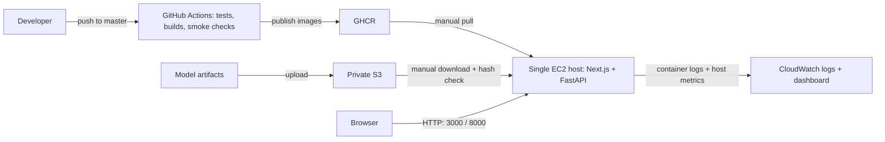

# Architecture & Design

### End-to-End System Architecture

The **Plant Disease Detection** demonstration connects a machine-learning inference API to a web frontend and supporting AWS services in the **Sydney (`ap-southeast-2`)** region. Its architecture has four main parts: model artifact storage, CI image publishing, a two-container runtime on one EC2 host, and basic monitoring. It demonstrates selected MLOps and cloud engineering practices; it does not provide validated agricultural diagnostics or an automated production release process.

1. **Model Checkpoint & Artifact Storage Pipeline (Amazon S3 &rarr; EC2 Host):** Securely decouples multi-megabyte neural network weights from application container images, verifying cryptographic integrity at runtime.
2. **CI Image Build and Publishing (GitHub Actions &rarr; GHCR):** Runs automated checks and publishes frontend and API images; an operator deploys releases to EC2 manually.
3. **Web Application & Model Inference (Single EC2 Host):** Runs a responsive Next.js frontend and a PyTorch CPU FastAPI service with an optional Grad-CAM++ visualization.
4. **Operations, Observability & Security:** Uses least-privilege AWS IAM instance profiles, client-restricted Security Groups, CloudWatch Logs, custom host memory and disk metrics, and a monitoring dashboard.

---

### End-to-End Operational Lifecycle & Sequence Flow

The interaction sequence across the nine steps in the architecture flow below is detailed below:

| Step # | Subsystem / Boundary | Source Component | Destination Component | Protocol / Mechanism | Technical Action & Description |
|:---:|---|---|---|---|---|
| **①** | Client Ingress | Users / Browser | VPC / Internet Gateway | `HTTP :3000 / :8000` | Approved client IPs access web UI and API ports through the VPC Internet Gateway and Security Group (`TCP 22, 3000, 8000`). |
| **②** | Web Frontend | Internet Gateway | `frontend` Container (EC2) | `GET :3000 (UI)` | Serves the Next.js standalone UI (`node server.js`) running as a non-root user. |
| **③** | AI Inference API | Internet Gateway / Browser | `backend` Container (EC2) | `POST :8000 (API)` | FastAPI + Uvicorn (1 worker) exposes `/health`, `/predict`, `/explain` using MobileNetV3-Small (KD) on CPU (`2 threads`, `1 slot`) with `/app/artifacts` mounted read-only (`ro`). |
| **④** | Source Control & CI | Developer (also operator) | GitHub (`master` branch) | `git push` &rarr; trigger | Pushing to `master` triggers GitHub Actions (`pytest · build · smoke`). |
| **⑤** | Container Publishing | GitHub Actions | GHCR | `publish` | CI builds and publishes digest-pinned `api` and `frontend` container images to GitHub Container Registry. |
| **⑥** | Manual Deployment | GHCR | Amazon EC2 (AL2023 `x86_64`) | `docker pull @sha256 digest` | Operator manually pulls immutable container images over SSH and recreates the containers on EC2. |
| **⑦** | Offline Training Upload | Local Workstation | Amazon S3 (Private Bucket) | `upload` | Training & audit workflow (`audit_models.py`, Kaggle tomato set) uploads `mobilenet-distilled-v1/model.pth` (~6 MiB) and `class_to_idx.json` (no VPC endpoint). |
| **⑧** | Artifact Retrieval | Amazon S3 | EC2 Host &rarr; `backend` | `aws s3 cp + sha256` | EC2 uses its AWS IAM instance profile (no static keys) to download weights, verify SHA256 hashes, and mount `/app/artifacts (ro)`. |
| **⑨** | Logging & Telemetry | EC2 Containers & CloudWatch Agent | Amazon CloudWatch | `awslogs` + host metrics | Containers stream `awslogs` and CloudWatch Agent reports `mem + disk` every 60 s. |

---

### Architectural Principles & Subsystem Breakdown

#### Subsystem 1: Decoupled Weights from Code
In enterprise MLOps, embedding multi-megabyte binary checkpoints directly into container images causes significant operational anti-patterns: base images swell to several gigabytes, build and push cycles stall, and minor weight updates require a complete container rebuild.

The architecture decouples application runtime code from model checkpoints:
1. **Compact Application Images:** The Docker image packages solely runtime code, library dependencies (FastAPI, PyTorch CPU, Next.js), and static templates.
2. **Dedicated Cloud Storage:** Model checkpoints reside securely in a private S3 bucket (`plant-disease-model-artifacts-ap-southeast-2`) under prefix `mobilenet-distilled-v1/`.
3. **Read-Only Container Mount:** During deployment, the host pulls the model artifacts via IAM role permissions, audits SHA256 hashes, and mounts `/home/ec2-user/checkpoints/v1` as a **read-only volume** (`/app/artifacts:ro`) into the FastAPI container.

#### Subsystem 2: Continuous Integration & Immutable Delivery
Every push to the `master` branch triggers an automated GitHub Actions workflow (`pytest · build · smoke`):
- **PyTest Schema & Transform Suite:** Validates input tensor normalization, PIL image decoding, and JSON response contracts.
- **Next.js Standalone Optimization & Smoke Tests:** Compiles TypeScript, packages a minimal Node.js 22 server, and runs container smoke checks.
- **Digest-Pinned Images:** Images (`api + frontend`) are published to GitHub Container Registry (GHCR) and pulled manually over SSH onto EC2 by immutable digest hash (`@sha256:f61be157...` and `@sha256:ec211d13...`), preventing mutable tag discrepancies.

#### Subsystem 3: Containerized Web & Model Inference
The compute layer runs on an Amazon Linux 2023 (`x86_64`) EC2 instance hosting two isolated containers:
- **Next.js Standalone Frontend (`:3000`):** Runs `node server.js` as low-privilege non-root user `nextjs` (UID 1001), serving responsive mobile and desktop client interfaces.
- **FastAPI Backend (`:8000`):** Python 3.12 + Uvicorn (`1 worker`) exposing `/health`, `/predict`, and `/explain`, with PyTorch CPU intra-op thread allocation restricted to 2 cores (`MODEL_THREADS=2`) and a single bounded execution slot (`1 slot`) to prevent CPU saturation.
- **MobileNetV3-Small Distilled:** The demo checkpoint is approximately 6 MiB. A recorded single-request CPU inference measured 29.23 ms; this measurement is not a throughput or full-request latency result, and evaluation results do not establish field accuracy.
- **Grad-CAM++ Visualization:** The `/explain` endpoint returns a heatmap and overlay as an aid for inspecting the model response. These visualizations do not segment lesions or verify a diagnosis.

#### Subsystem 4: Operations, Least-Privilege Security & Observability
- **AWS IAM Instance Profile:** Instance role with no static access keys, scoped to `s3:GetObject` on the model bucket and `CloudWatchAgentServerPolicy`.
- **Amazon VPC & Security Groups:** Inbound firewall restricts ports `22` (SSH), `3000` (Web UI), and `8000` (API) exclusively to approved source IPs (`/32`).
- **Amazon CloudWatch Logs:** Captures stdout and stderr streams with a **7-day retention policy** to prevent disk saturation while maintaining troubleshooting history.
- **Amazon CloudWatch Agent:** Collects host memory and disk metrics under namespace `PlantDisease/Host`; CloudWatch Logs stores both containers’ output and the dashboard provides an operational view.

---

### Model Artifact Boundary

The checkpoint and class map are stored in a private S3 bucket rather than inside the application image. During a manual release, the operator downloads both files, verifies their SHA256 hashes, and mounts the directory read-only into the API container. The download and verification commands are part of the deployment procedure in [5.4](../5.4-deployment-strategy/).

The current demo reaches the regional S3 endpoint through its public subnet route. A private S3 VPC endpoint is a possible later network enhancement and is not part of the deployed configuration.
