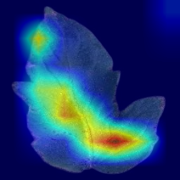
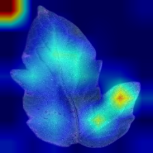

# Kiến trúc & Thiết kế

### Tổng quan Kiến trúc Toàn diện Hệ thống

Bản demo **Plant Disease Detection** kết nối API suy luận học máy với giao diện web và một số dịch vụ AWS tại khu vực **Sydney (`ap-southeast-2`)**. Kiến trúc gồm bốn phần: lưu trữ artifacts mô hình, CI phát hành image, hai container chạy trên cùng một EC2 và giám sát cơ bản. Đây là ví dụ thực hành một số kỹ thuật MLOps và cloud; hệ thống chưa cung cấp chức năng chẩn đoán nông nghiệp đã được xác minh và chưa tự động triển khai bản phát hành production:

1. **Phân hệ Lưu trữ Trọng số & Tách rời Artifacts (Amazon S3 &rarr; Máy chủ EC2):** Tách biệt các tệp trọng số mạng nơ-ron nhị phân khỏi container image, đảm bảo tính toàn vẹn mật mã học SHA256 tại thời điểm chạy.
2. **Quy trình Phân phối Liên tục & Đóng gói Container (GitHub Actions &rarr; GHCR &rarr; EC2):** Tự động kiểm thử và phát hành container image frontend cùng API lên GHCR; kỹ sư vận hành triển khai phiên bản lên EC2 theo quy trình thủ công.
3. **Phân hệ Thực thi Web & Suy luận Trí tuệ Nhân tạo (Docker Stack trên EC2):** Chạy giao diện người dùng tương tác Next.js và dịch vụ suy luận FastAPI PyTorch CPU tích hợp công nghệ giải thích Grad-CAM++.
4. **Phân hệ Vận hành, An ninh & Giám sát Hệ thống:** Áp dụng nguyên tắc đặc quyền tối thiểu với IAM Role, Security Group khóa địa chỉ IP client, thu thập log với CloudWatch Logs, đo đạc RAM tùy biến với CloudWatch Agent và kích hoạt cảnh báo email qua Amazon SNS.


---

### Bảng Mô tả 11 Bước Vận hành Hệ thống Chi tiết

Chuỗi tương tác xuyên suốt 11 bước được đánh số trên sơ đồ kiến trúc như sau:

| Bước # | Phân hệ / Ranh giới | Thành phần Khởi phát | Thành phần Tiếp nhận | Giao thức / Cơ chế | Mô tả Kỹ thuật Chi tiết |
|:---:|---|---|---|---|---|
| **①** | Truy cập Client | Users / Browser | VPC / Internet Gateway | `HTTP :3000 / :8000` | Các địa chỉ IP được phê duyệt truy cập giao diện Web và API qua Internet Gateway và Security Group (`TCP 22, 3000, 8000`). |
| **②** | Giao diện Web | Internet Gateway | Container `frontend` (EC2) | `GET :3000 (UI)` | Phục vụ giao diện Next.js standalone (`node server.js`) chạy dưới tài khoản non-root user. |
| **③** | API Suy luận AI | Internet Gateway / Browser | Container `backend` (EC2) | `POST :8000 (API)` | FastAPI + Uvicorn (1 worker) cung cấp `/health`, `/predict`, `/explain` chạy MobileNetV3-Small (KD) trên CPU (`2 threads`, `1 slot`) với `/app/artifacts` gắn chỉ đọc (`ro`). |
| **④** | Mã nguồn & CI | Developer (kiêm vận hành) | GitHub (nhánh `master`) | `git push` &rarr; trigger | Đẩy code lên `master` kích hoạt GitHub Actions (`pytest · build · smoke`). |
| **⑤** | Phát hành Image | GitHub Actions | GHCR | `publish` | CI build và đẩy các container image `api` và `frontend` lên GitHub Container Registry. |
| **⑥** | Triển khai Thủ công | GHCR | Amazon EC2 (AL2023 `x86_64`) | `docker pull @sha256 digest` | Kỹ sư vận hành kết nối SSH để kéo image theo mã digest bất biến và khởi chạy lại container trên EC2. |
| **⑦** | Tải lên Trọng số | Local Workstation | Amazon S3 (Private Bucket) | `upload` | Quy trình huấn luyện & kiểm định (`audit_models.py`, tập dữ liệu cà chua Kaggle) tải `mobilenet-distilled-v1/model.pth` (~6 MiB) và `class_to_idx.json` lên S3 (không dùng VPC endpoint). |
| **⑧** | Nạp Trọng số | Amazon S3 | Máy chủ EC2 &rarr; `backend` | `aws s3 cp + sha256` | EC2 sử dụng IAM instance profile (không lưu key tĩnh) để tải tệp trọng số, kiểm tra mã băm SHA256 và gắn `/app/artifacts (ro)`. |
| **⑨** | Ghi log & Giám sát | EC2 Containers & CloudWatch Agent | Amazon CloudWatch | `awslogs` + host metrics | Container đẩy log qua `awslogs` và CloudWatch Agent gửi thông số `mem + disk` mỗi 60 giây. |
| **⑩** | Cảnh báo Ngưỡng | Amazon CloudWatch | Amazon SNS (`plant-disease-alerts`) | `RAM > 85%, 3 × 1 min` | CloudWatch Alarm kích hoạt khi mức sử dụng RAM vượt 85% trong 3 chu kỳ 1 phút liên tiếp. |
| **⑪** | Thông báo Sự cố | Amazon SNS | Developer / Operator | `email alert` | SNS gửi email cảnh báo tức thời đến hộp thư của kỹ sư vận hành. |

---

### Phân tích Chuyên sâu 4 Phân hệ Kiến trúc

#### Phân hệ 1: Nguyên tắc Tách rời Trọng số Mô hình khỏi Mã nguồn
Trong môi trường MLOps chuẩn doanh nghiệp, việc đóng gói trực tiếp các tệp trọng số nhị phân nặng hàng trăm megabyte vào Docker image gây ra nhiều hệ lụy: container image bị phình to dung lượng, chu kỳ build/push kéo dài, và mỗi khi cập nhật phiên bản mô hình lại buộc phải build lại toàn bộ ứng dụng.

Kiến trúc **Plant Disease Detection** tách biệt hoàn toàn giữa mã nguồn và tệp mô hình:
1. **Container Image Nhẹ và Tối giản:** Image Docker chỉ đóng gói mã logic ứng dụng, thư viện phụ thuộc (FastAPI, PyTorch CPU, Next.js) và tài nguyên tĩnh.
2. **Lưu trữ Chuyên biệt trên Đám mây:** Tệp checkpoint PyTorch (`model.pth`) và từ điển nhãn (`class_to_idx.json`) nằm trong S3 bucket riêng tư (`plant-disease-model-artifacts-ap-southeast-2`) dưới tiền tố `mobilenet-distilled-v1/`.
3. **Tiếp nhận An toàn khi Triển khai:** Khi máy chủ khởi chạy, instance profile IAM cấp quyền tải tệp, kiểm tra mã băm SHA256 và gắn kết ổ đĩa chỉ đọc (**read-only volume** `/app/artifacts:ro`) vào container FastAPI.

#### Phân hệ 2: Tích hợp Liên tục & Phân phối Bất biến
Mọi thao tác đẩy commit lên nhánh `master` trên GitHub đều kích hoạt quy trình CI/CD tự động (`pytest · build · smoke`):
- **Bộ Kiểm thử PyTest Tự động:** Kiểm định tính đúng đắn của logic tiền xử lý tensor, giải mã ảnh PIL và kiểm tra định dạng dữ liệu đầu ra JSON.
- **Tối ưu hóa Next.js Standalone & Smoke Test:** Biên dịch TypeScript, đóng gói máy chủ Node.js 22 độc lập và chạy kiểm thử smoke container.
- **Gắn mã Digest Cố định:** Các image (`api + frontend`) đẩy lên GitHub Container Registry (GHCR) và được kéo thủ công qua SSH về EC2 theo mã băm digest bất biến (`@sha256:f61be157...` và `@sha256:ec211d13...`), loại bỏ hoàn toàn rủi ro sai lệch do ghi đè tag `:latest`.

#### Phân hệ 3: Container Web và Suy luận Mô hình
Phân hệ tính toán chạy trên một máy chủ ảo EC2 Amazon Linux 2023 (`x86_64`) với hai container độc lập:
- **Next.js Standalone Frontend (`:3000`):** Chạy `node server.js` dưới tài khoản không có quyền root `nextjs` (UID 1001), phục vụ giao diện người dùng đáp ứng đa nền tảng (Mobile/Desktop).
- **FastAPI Backend (`:8000`):** Dịch vụ Python 3.12 + Uvicorn (`1 worker`) cung cấp các endpoint `/health`, `/predict`, `/explain`, giới hạn số luồng xử lý PyTorch CPU ở mức 2 core (`MODEL_THREADS=2`) và `1 slot` thực thi tuần tự để ngăn chặn quá tải CPU.
- **MobileNetV3-Small chưng cất:** Checkpoint dùng cho demo có dung lượng khoảng 6 MiB. Một lần đo suy luận CPU được ghi nhận là 29,23 ms; đây không phải kết quả throughput hay độ trễ toàn bộ request. Kết quả đánh giá không chứng minh độ chính xác ngoài thực địa.
- **Trực quan hóa Grad-CAM++:** Endpoint `/explain` trả về bản đồ nhiệt và ảnh phủ để tham khảo vùng ảnh liên quan đến phản hồi của mô hình. Các hình ảnh này không phân đoạn tổn thương hoặc xác nhận chẩn đoán.

#### Phân hệ 4: Vận hành, An ninh Phân quyền Tối thiểu & Giám sát
- **IAM Instance Profile:** Sử dụng instance role không lưu khóa truy cập tĩnh, cấp quyền `s3:GetObject` trên bucket trọng số và policy `CloudWatchAgentServerPolicy`.
- **Amazon VPC & Security Groups:** Tường lửa bảo vệ chỉ cho phép truy cập các cổng `22` (SSH), `3000` (Web UI) và `8000` (API) từ các IP nguồn được phê duyệt (`/32`).
- **Amazon CloudWatch Logs:** Thu thập toàn bộ luồng log stdout/stderr với chính sách lưu trữ **7 ngày**, cân đối giữa nhu cầu khắc phục sự cố và tối ưu chi phí lưu trữ.
- **CloudWatch Agent & Alarm:** Thu thập mức sử dụng RAM thực tế (`mem_used_percent`) trong namespace `PlantDisease/Host`. Chuông báo động kích hoạt khi RAM **vượt quá 85% trong 3 phút liên tục**, gửi email cảnh báo qua **Amazon SNS**.

---

### 5.3.1 Chuẩn bị Danh tính và Quyền hạn Tải Tệp

Trước khi thực hiện tải tệp, cần đảm bảo máy chủ EC2 đã được gắn IAM Role phù hợp và có thể kết nối với dịch vụ S3 trong khu vực:

```bash
# Xác thực danh tính IAM Role của máy ảo EC2
aws sts get-caller-identity

# Đặt biến môi trường làm việc khu vực Sydney
export AWS_DEFAULT_REGION="ap-southeast-2"
read -r -p "Nhập tên S3 bucket lưu model: " MODEL_BUCKET

# Tạo thư mục lưu trữ trọng số trên máy chủ
mkdir -p checkpoints/v1
```

> [!NOTE]
> Bản demo hiện tại truy cập dịch vụ S3 qua bảng định tuyến internet thông thường của public subnet ra Internet Gateway. Đối với môi trường doanh nghiệp có subnet riêng tư (private subnet), người quản trị nên tạo thêm một **Amazon S3 Gateway VPC Endpoint** để lưu lượng tải tệp đi hoàn toàn trên mạng nội bộ của AWS với chi phí đường truyền bằng 0.

---

### 5.3.2 Tải về và Kiểm tra Tính Toàn vẹn của Artifacts

Chạy các lệnh sau để tải tệp checkpoint mô hình và từ điển phân lớp từ S3, sau đó tiến hành kiểm tra mã băm mật mã học SHA256:

```bash
# Tải tệp mô hình và tệp ánh xạ nhãn
aws s3 cp "s3://$MODEL_BUCKET/mobilenet-distilled-v1/model.pth" checkpoints/v1/model.pth
aws s3 cp "s3://$MODEL_BUCKET/mobilenet-distilled-v1/class_to_idx.json" checkpoints/v1/class_to_idx.json

# Xác thực mã băm SHA256
sha256sum checkpoints/v1/model.pth checkpoints/v1/class_to_idx.json
```

#### Bảng Đối soát Mã băm Ghi nhận Thực tế

Các tệp tải về phải khớp tuyệt đối với mã băm đã được kiểm định từ quá trình huấn luyện và đánh giá ngoại tuyến:

| Tên Tệp | Mã băm SHA256 Tiêu chuẩn | Dung lượng | Trạng thái Kiểm định |
|---|---|---|---|
| `model.pth` | `05e72798a74193499f17c4c8267c1436e8bc65cc1e8b8037245664a17644efa5` | `~6.0 MiB` | **TRÙNG KHỚP** |
| `class_to_idx.json` | `ff5c73e7a7e3e495593fa664b75ebc73de4c9a425f1d847351ae60bc1fbaa786` | `~1.2 KiB` | **TRÙNG KHỚP** |

> [!IMPORTANT]
> Sai khác mã băm SHA256 đồng nghĩa tệp tải về bị lỗi, phiên bản không đồng bộ hoặc đã bị chỉnh sửa bất thường. Backend FastAPI sẽ từ chối khởi động và trả về mã lỗi 503 nếu trọng số không hợp lệ.

---

### So sánh Hình ảnh Giải thích Quyết định Mô hình

Hai mô hình tạo ra các bản đồ nhiệt khác nhau trên ảnh ví dụ. Bản đồ này minh họa phản hồi của mô hình, không chứng minh vùng bệnh hoặc tính đúng đắn của dự đoán:

| Mô hình Giáo viên (ConvNeXt-Tiny) | Mô hình Học sinh (MobileNetV3-Small Chưng cất) |
|---|---|
|  |  |
| Các vùng được làm nổi bật khác nhau giữa hai mô hình | Bản đồ nhiệt chỉ trực quan hóa phản hồi; không xác nhận tổn thương |
