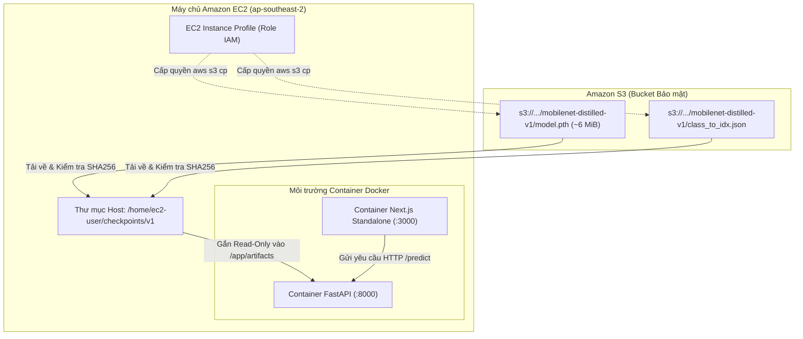

# Kiến trúc & Thiết kế

### Nguyên tắc Kiến trúc: Tách rời Trọng số Mô hình khỏi Mã nguồn

Trong quy trình phát triển và vận hành học máy (MLOps), việc đóng gói trực tiếp các tệp trọng số mô hình nặng hàng trăm megabyte vào Docker image gây ra nhiều hạn chế lớn: làm phình to dung lượng container image, kéo dài thời gian build/push, và mỗi khi cập nhật mô hình lại phải build lại toàn bộ ứng dụng.

Kiến trúc của hệ thống **Plant Disease Detection** tách biệt hoàn toàn giữa môi trường thực thi và tệp mô hình:
1. **Container Image:** Chỉ chứa mã nguồn xử lý, thư viện phụ thuộc (FastAPI, PyTorch CPU, Next.js) và các tài nguyên tĩnh, giúp image nhẹ và dễ triển khai.
2. **Lưu trữ Trọng số trên Amazon S3:** Tệp checkpoint PyTorch (`model.pth`) và từ điển nhãn phân lớp (`class_to_idx.json`) được lưu trữ tại một S3 bucket riêng tư có kiểm soát quyền truy cập.
3. **Tiếp nhận tại Thời điểm Chạy:** Khi triển khai lên EC2, máy chủ dùng quyền IAM để tải tệp mô hình, xác thực mã băm SHA256 và gắn kết ổ đĩa chỉ đọc (**read-only mount**) vào thư mục `/app/artifacts` của container suy luận.



---

### 5.3.1 Chuẩn bị Danh tính và Quyền hạn Tải Tệp

Trước khi thực hiện tải tệp, cần đảm bảo máy chủ EC2 đã được gắn IAM Role phù hợp và có thể kết nối với dịch vụ S3 trong khu vực:

```bash
# Xác thực danh tính IAM Role của máy ảo EC2
aws sts get-caller-identity

# Đặt biến môi trường làm việc
export AWS_DEFAULT_REGION="ap-southeast-2"
read -r -p "Nhập tên S3 bucket lưu model: " MODEL_BUCKET

# Tạo thư mục lưu trữ trọng số trên máy chủ
mkdir -p checkpoints/v1
```

> [!NOTE]
> Bản demo hiện tại truy cập dịch vụ S3 qua bảng định tuyến internet thông thường của public subnet. Đối với môi trường doanh nghiệp có subnet riêng tư (private subnet), người quản trị nên tạo thêm một **Amazon S3 Gateway VPC Endpoint** để lưu lượng tải tệp đi hoàn toàn trên mạng nội bộ của AWS với chi phí đường truyền bằng 0.

---

### 5.3.2 Tải về và Kiểm tra Tính Toàn vẹn của Artifacts

Chạy các lệnh sau để tải tệp checkpoint mô hình và từ điển phân lớp từ S3, sau đó tiến hành kiểm tra mã băm mật mã học SHA256:

```bash
# Tải tệp mô hình và tệp ánh xạ nhãn
aws s3 cp "s3://$MODEL_BUCKET/mobilenet-distilled-v1/model.pth" checkpoints/v1/model.pth
aws s3 cp "s3://$MODEL_BUCKET/mobilenet-distilled-v1/class_to_idx.json" checkpoints/v1/class_to_idx.json

# Xác thực mã băm SHA256
sha256sum checkpoints/v1/model.pth checkpoints/v1/class_to_idx.json
```

#### Bảng Đối soát Mã băm Ghi nhận Thực tế

Các tệp tải về phải khớp tuyệt đối với mã băm đã được kiểm định từ quá trình huấn luyện:

| Tên Tệp | Mã băm SHA256 Tiêu chuẩn | Dung lượng | Trạng thái Kiểm định |
|---|---|---|---|
| `model.pth` | `05e72798a74193499f17c4c8267c1436e8bc65cc1e8b8037245664a17644efa5` | `~6.0 MiB` | **TRÙNG KHỚP** |
| `class_to_idx.json` | `ff5c73e7a7e3e495593fa664b75ebc73de4c9a425f1d847351ae60bc1fbaa786` | `~1.2 KiB` | **TRÙNG KHỚP** |

> [!IMPORTANT]
> Sai khác mã băm SHA256 đồng nghĩa tệp tải về bị lỗi, phiên bản không đồng bộ hoặc đã bị chỉnh sửa bất thường. Backend FastAPI sẽ từ chối khởi động và trả về mã lỗi 503 nếu trọng số không hợp lệ.

---

### So sánh Hình ảnh Giải thích Quyết định Mô hình

Trọng số MobileNetV3-Small sau khi chưng cất tri thức tái hiện xuất sắc khả năng chú ý vùng bệnh học tương tự như mô hình giáo viên ConvNeXt-Tiny:

| Mô hình Giáo viên (ConvNeXt-Tiny) | Mô hình Học sinh (MobileNetV3-Small Chưng cất) |
|---|---|
|  |  |
| Vùng bao phủ rộng, nhận diện đặc trưng toàn diện | Tập trung chính xác vào rìa hoại tử và vùng tổn thương cục bộ |
