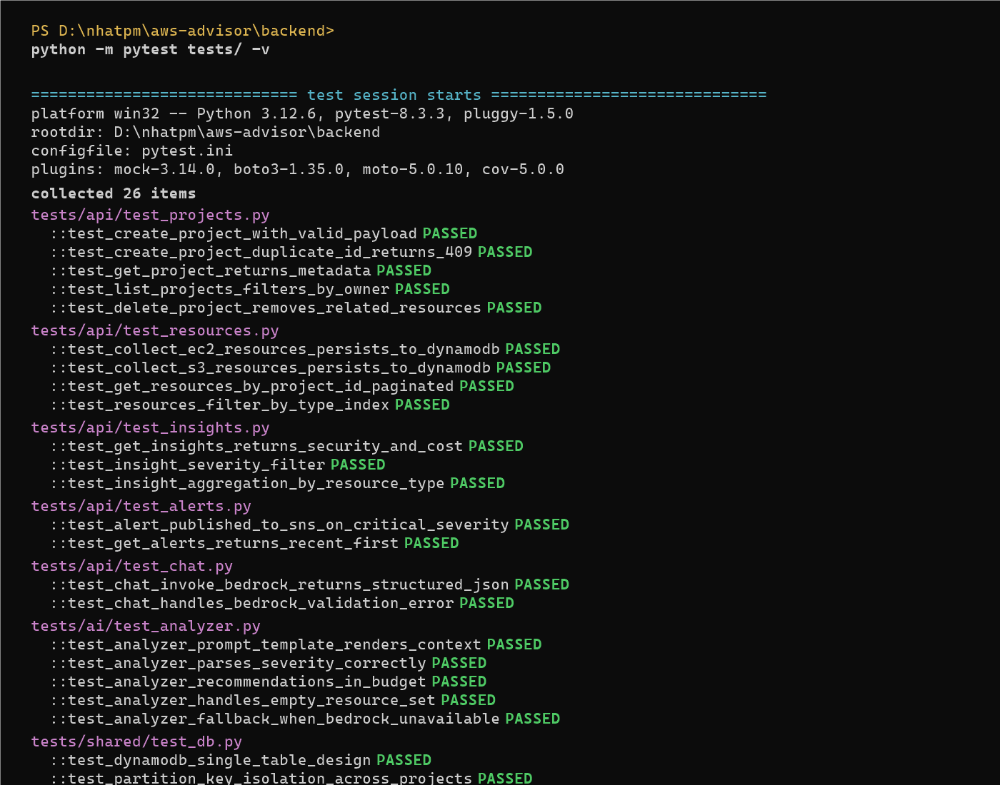
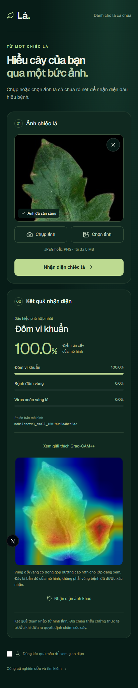

# Deployment Strategy

### 5.4.1 CI Build and Image Publishing

Pushes to `master` trigger the automated continuous integration (CI) workflow in **GitHub Actions** (`.github/workflows/ci.yml`):
1. Python static code analysis, linting, and unit test suites across model transforms and prediction schemas.
2. Next.js production builds, ensuring static asset optimization, TypeScript type safety, and non-root runtime compatibility.
3. Multi-stage Docker image packaging for the frontend and inference API, followed by publishing to **GHCR (GitHub Container Registry)**. The workflow does not deploy to EC2; release deployment and rollback are performed manually.

#### Recorded Release Provenance

To guarantee reproducibility and avoid mutable tag discrepancies (such as `:latest`), the deployment recorded immutable git commit hashes and image digests:

| Component | Target Version / Identifier | Recorded Digest Hash |
|---|---|---|
| **Git Commit** | `ff6b75bf3a625db124cc6449f52fa224bf76631e` | Validated release baseline |
| **Backend API Image** | `ghcr.io/starkkk1/plant-disease-api` | `sha256:f61be1570a834f1819614ad041f79e6114e00a0503852a121a564725cad4c27c` |
| **Frontend Image** | `ghcr.io/starkkk1/plant-disease-frontend` | `sha256:ec211d13241680f208b29f8282c7fb12a19735e9048d1f8dab9b6a27499a7f85` |



---

### 5.4.2 Retrieve and Verify Model Artifacts

Before starting the API container, confirm that the EC2 instance has assumed its IAM role, then download the checkpoint and class map from the private S3 bucket:

```bash
# Verify the EC2 instance profile identity and set the deployment region
aws sts get-caller-identity
export AWS_DEFAULT_REGION="ap-southeast-2"
read -r -p "Enter S3 bucket name: " MODEL_BUCKET

# Download model weights and class map
mkdir -p /home/ec2-user/checkpoints/v1
aws s3 cp "s3://$MODEL_BUCKET/mobilenet-distilled-v1/model.pth" /home/ec2-user/checkpoints/v1/model.pth
aws s3 cp "s3://$MODEL_BUCKET/mobilenet-distilled-v1/class_to_idx.json" /home/ec2-user/checkpoints/v1/class_to_idx.json

# Verify SHA256 checksums
sha256sum /home/ec2-user/checkpoints/v1/model.pth /home/ec2-user/checkpoints/v1/class_to_idx.json
```

The downloaded files must match the release hashes:

| Artifact | Expected SHA256 | Approximate size |
|---|---|---:|
| `model.pth` | `05e72798a74193499f17c4c8267c1436e8bc65cc1e8b8037245664a17644efa5` | ~6.0 MiB |
| `class_to_idx.json` | `ff5c73e7a7e3e495593fa664b75ebc73de4c9a425f1d847351ae60bc1fbaa786` | ~1.2 KiB |

> [!IMPORTANT]
> If a hash differs, stop the release and check that the files belong to the same model version. The API reports the model as unavailable if required artifacts are missing or invalid.

> [!NOTE]
> This demo downloads artifacts through the public subnet's route to the regional S3 endpoint. A private S3 VPC endpoint is a possible future network change, not part of the current setup.

---

### 5.4.3 Configure Backend Runtime

The backend container runs a FastAPI application under Python 3.12 with PyTorch CPU. The host mounts the previously downloaded `checkpoints/v1` directory as a **read-only volume** at `/app/artifacts`.

Start the backend container with the following configuration:

```bash
docker run -d \
  --name plant-disease-api \
  --restart unless-stopped \
  -p 8000:8000 \
  -v /home/ec2-user/checkpoints/v1:/app/artifacts:ro \
  -e MODEL_CHECKPOINT=/app/artifacts/model.pth \
  -e MODEL_CLASS_MAP=/app/artifacts/class_to_idx.json \
  -e MODEL_NAME=mobilenetv3_small_100 \
  -e MODEL_THREADS=2 \
  -e CORS_ORIGINS="http://localhost:3000,http://$(curl -s http://checkip.amazonaws.com):3000" \
  --log-driver awslogs \
  --log-opt awslogs-region=ap-southeast-2 \
  --log-opt awslogs-group=/plant-disease/backend \
  --log-opt awslogs-create-group=true \
  ghcr.io/starkkk1/plant-disease-api@sha256:f61be1570a834f1819614ad041f79e6114e00a0503852a121a564725cad4c27c
```

> [!NOTE]
> - `MODEL_THREADS=2` restricts PyTorch intra-op parallelism to 2 CPU cores, preventing inference requests from overwhelming the host OS.
> - The application initializes the neural network weights strictly once at process startup. If weights are missing, corrupt, or incompatible, `/health` reports status `unavailable` and API calls return 503.

---

### 5.4.4 Configure Frontend and Networking

The frontend is packaged using a multi-stage Docker build producing a **Next.js Standalone** server running on Node.js 22, matching the frontend Dockerfile. The container runs as a dedicated non-root `nextjs` user and listens on port `3000`.

Start the frontend container:

```bash
docker run -d \
  --name plant-disease-frontend \
  --restart unless-stopped \
  -p 3000:3000 \
  -e NODE_ENV=production \
  -e PORT=3000 \
  --log-driver awslogs \
  --log-opt awslogs-region=ap-southeast-2 \
  --log-opt awslogs-group=/plant-disease/frontend \
  --log-opt awslogs-create-group=true \
  ghcr.io/starkkk1/plant-disease-frontend@sha256:ec211d13241680f208b29f8282c7fb12a19735e9048d1f8dab9b6a27499a7f85
```

---

### 5.4.5 Validate Application Behavior

Verify that both containers are running healthy, then execute health checks and a test prediction using the fixture leaf image:

```bash
# 1. Check running containers
sudo docker ps

# 2. Check Backend Health
curl --fail http://127.0.0.1:8000/health

# 3. Check Frontend HTTP Header
curl -I http://127.0.0.1:3000

# 4. Perform Live Inference with Fixture Image
curl --fail-with-body \
  -F "file=@frontend/tests/fixtures/tomato-leaf.jpg;type=image/jpeg" \
  -F "top_k=3" \
  http://127.0.0.1:8000/predict
```

#### Recorded Verification Results

The table below documents the empirical test results recorded on the Sydney EC2 deployment:

| Validation Check | Command / Endpoint | Recorded Result | Evidence Status |
|---|---|---|---|
| **Artifact Integrity** | `sha256sum` | Both `model.pth` and `class_to_idx.json` match release hashes | **PASSED** |
| **Backend Status** | `GET /health` | `{"status": "ok", "api_version": "1.0", "is_mock": false}` | **PASSED** |
| **Frontend Status** | `GET /` | `HTTP/1.1 200 OK` | **PASSED** |
| **Live Inference** | `POST /predict` | `model_version: mobilenetv3_small_100:05e72798a741` | **PASSED** |
| **Prediction Latency** | Timing metric | **29.23 ms** CPU processing time | **PASSED** |
| **Top Predicted Class** | Sample fixture | **`Tomato___Bacterial_spot`** with confidence **0.7058** | **PASSED** |
| **Cross-Device UI** | Desktop & Mobile | Full responsive rendering and interactive UI confirmed | **PASSED** |



The test fixture image utilized for validation (`tomato-leaf.jpg`):


