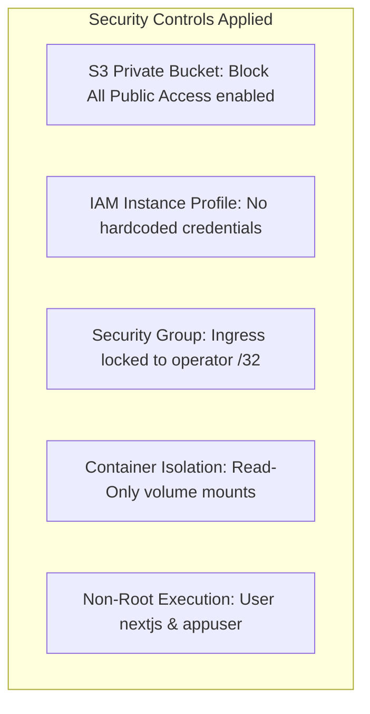

# 5.5 Monitoring, CloudWatch Alarms & Access Control

### 5.5.1 Container Logging & Host Metrics Collection

Production observabilty relies on **Amazon CloudWatch Logs** and the **Amazon CloudWatch Agent**:

#### 1. Container Structured Logging
The Docker daemon uses the `awslogs` log driver to stream all `stdout` and `stderr` output directly to dedicated CloudWatch Log Groups:
- `/plant-disease/backend`: Captures structured JSON middleware access logs, including `request_id`, client IP, HTTP method, request path, status code, and execution duration.
- `/plant-disease/frontend`: Captures Next.js server requests, static file requests, and rendering errors.
- **Log Retention:** Set to **7 days** to minimize storage overhead while preserving troubleshooting history.

Inspect real-time application logs using the AWS CLI:

```bash
# Stream the last 10 minutes of backend API logs
aws logs tail /plant-disease/backend --since 10m --region ap-southeast-2

# Filter for errors or warnings
aws logs filter-log-events \
  --log-group-name /plant-disease/backend \
  --filter-pattern "ERROR" \
  --region ap-southeast-2
```

#### 2. CloudWatch Agent Metrics
While standard EC2 monitoring provides hypervisor-level CPU utilization, memory and disk metrics are not visible from the hypervisor. The **Amazon CloudWatch Agent** is configured on the host to collect and report memory and disk telemetry every 60 seconds under the custom namespace `PlantDisease/Host`:

Create `/opt/aws/amazon-cloudwatch-agent/etc/amazon-cloudwatch-agent.json`:

```json
{
  "metrics": {
    "namespace": "PlantDisease/Host",
    "metrics_collected": {
      "mem": {
        "measurement": [
          "mem_used_percent"
        ],
        "metrics_collection_interval": 60
      },
      "disk": {
        "measurement": [
          "disk_used_percent"
        ],
        "metrics_collection_interval": 60,
        "resources": [
          "/"
        ]
      }
    }
  }
}
```

Start the CloudWatch Agent service and verify status:

```bash
sudo /opt/aws/amazon-cloudwatch-agent/bin/amazon-cloudwatch-agent-ctl \
  -a fetch-config -m ec2 -s -c file:/opt/aws/amazon-cloudwatch-agent/etc/amazon-cloudwatch-agent.json

# Check agent status
sudo /opt/aws/amazon-cloudwatch-agent/bin/amazon-cloudwatch-agent-ctl -a status
```

---

### 5.5.2 Configure Host RAM Saturation Alarm

To protect the single-host deployment from memory exhaustion caused by unexpected traffic surges, configure a CloudWatch Alarm on host memory usage:

#### Alarm Specification

| Metric Parameter | Target Setting |
|---|---|
| **Namespace** | `PlantDisease/Host` |
| **Metric Name** | `mem_used_percent` |
| **Statistic** | Average |
| **Evaluation Period** | 60 seconds (1 minute) |
| **Breach Threshold** | Greater than **85%** (`> 85`) |
| **Evaluation Window** | 3 consecutive periods out of 3 (3 breaching datapoints) |
| **Missing Data Treatment** | Treat missing data as missing |
| **Alarm Action** | Publish notification to SNS topic `plant-disease-alerts` |

Create the SNS notification topic and alarm via the AWS CLI:

```bash
# 1. Create SNS topic
SNS_TOPIC_ARN=$(aws sns create-topic \
  --name plant-disease-alerts \
  --region ap-southeast-2 \
  --query 'TopicArn' --output text)

# 2. Subscribe operator email address
aws sns subscribe \
  --topic-arn "$SNS_TOPIC_ARN" \
  --protocol email \
  --notification-endpoint "your-email@example.com" \
  --region ap-southeast-2

# 3. Create CloudWatch Metric Alarm
aws cloudwatch put-metric-alarm \
  --alarm-name "PlantDisease-HighMemoryUtilization" \
  --alarm-description "Triggers when host memory exceeds 85% for 3 consecutive minutes" \
  --namespace "PlantDisease/Host" \
  --metric-name "mem_used_percent" \
  --statistic Average \
  --period 60 \
  --threshold 85 \
  --comparison-operator GreaterThanThreshold \
  --evaluation-periods 3 \
  --datapoints-to-alarm 3 \
  --alarm-actions "$SNS_TOPIC_ARN" \
  --region ap-southeast-2
```

> [!TIP]
> **Controlled Testing:** To verify email dispatch without artificially exhausting system memory, temporarily lower the alarm threshold to `0%` (`--threshold 0`). Confirm that CloudWatch transitions to the `ALARM` state and an email arrives in your inbox. Once confirmed, restore the threshold to `85%` and verify the alarm returns to `OK`.

---

### 5.5.3 Security Hardening & Least Privilege

The architecture adheres strictly to AWS Well-Architected security best practices:



1. **Private S3 Bucket:** S3 Block Public Access is completely enabled. Model weights are accessible solely by authenticated requests bearing the EC2 instance's assumed IAM role.
2. **Elimination of Long-Lived Credentials:** No access keys, secret keys, or private SSH keys are stored in source control or on the server file system.
3. **Read-Only Container Mounts:** The model weights directory `/app/artifacts` is mounted into the container with the `:ro` flag, ensuring the inference engine cannot mutate model checkpoints.
4. **Non-Root Execution:** The production container images create and execute under dedicated low-privilege system accounts (`nextjs` UID 1001 for frontend, `appuser` for backend).


