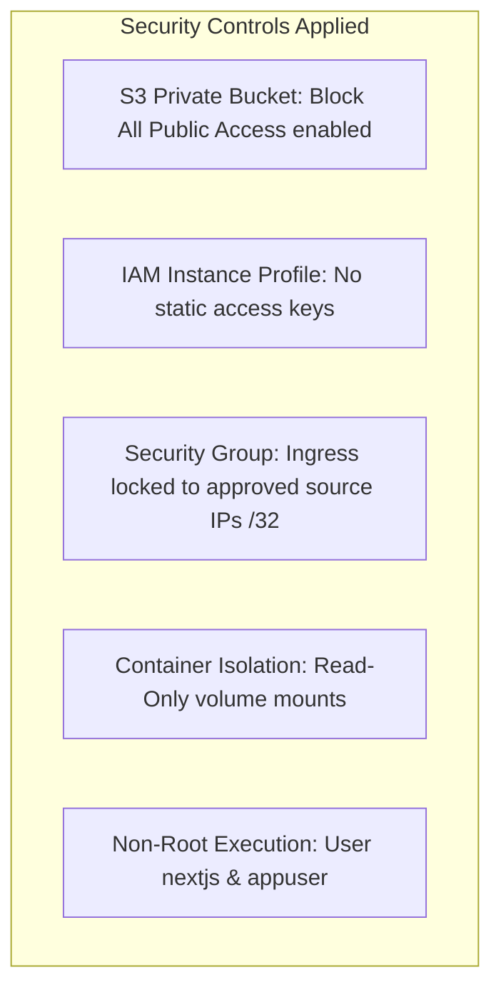

# Monitoring & Security

### 5.5.1 Container Logging & Host Metrics Collection

The demonstration's basic observability uses **Amazon CloudWatch Logs** and the **Amazon CloudWatch Agent**:

#### 1. Container Structured Logging
The Docker daemon uses the `awslogs` log driver to stream all `stdout` and `stderr` output directly to dedicated CloudWatch Log Groups:
- `/plant-disease/backend`: Captures structured JSON middleware access logs, including `request_id`, client IP, HTTP method, request path, status code, and execution duration.
- `/plant-disease/frontend`: Captures Next.js server requests, static file requests, and rendering errors.
- **Log Retention:** Set to **7 days** to minimize storage overhead while preserving troubleshooting history.

Inspect real-time application logs using the AWS CLI:

```bash
# Stream the last 10 minutes of backend API logs
aws logs tail /plant-disease/backend --since 10m --region ap-southeast-2

# Filter for errors or warnings
aws logs filter-log-events \
  --log-group-name /plant-disease/backend \
  --filter-pattern "ERROR" \
  --region ap-southeast-2
```

#### 2. CloudWatch Agent Metrics
While standard EC2 monitoring provides hypervisor-level CPU utilization, memory and disk metrics are not visible from the hypervisor. The **Amazon CloudWatch Agent** is configured on the host to collect and report memory and disk telemetry every 60 seconds under the custom namespace `PlantDisease/Host`:

Create `/opt/aws/amazon-cloudwatch-agent/etc/amazon-cloudwatch-agent.json`:

```json
{
  "metrics": {
    "namespace": "PlantDisease/Host",
    "metrics_collected": {
      "mem": {
        "measurement": [
          "mem_used_percent"
        ],
        "metrics_collection_interval": 60
      },
      "disk": {
        "measurement": [
          "disk_used_percent"
        ],
        "metrics_collection_interval": 60,
        "resources": [
          "/"
        ]
      }
    }
  }
}
```

Start the CloudWatch Agent service and verify status. The current deployment also provides the `plant-disease-demo` CloudWatch dashboard for reviewing host metrics alongside logs:

```bash
sudo /opt/aws/amazon-cloudwatch-agent/bin/amazon-cloudwatch-agent-ctl \
  -a fetch-config -m ec2 -s -c file:/opt/aws/amazon-cloudwatch-agent/etc/amazon-cloudwatch-agent.json

# Check agent status
sudo /opt/aws/amazon-cloudwatch-agent/bin/amazon-cloudwatch-agent-ctl -a status
```

---

### 5.5.2 Security Hardening & Least Privilege

The demonstration applies a small set of access and runtime controls:



1. **Private S3 Bucket:** S3 Block Public Access is completely enabled. Model weights are accessible solely by authenticated requests bearing the EC2 instance's assumed IAM role.
2. **Elimination of Long-Lived Credentials:** No access keys, secret keys, or private SSH keys are stored in source control or on the server file system.
3. **Read-Only Container Mounts:** The model weights directory `/app/artifacts` is mounted into the container with the `:ro` flag, ensuring the inference engine cannot mutate model checkpoints.
4. **Non-Root Execution:** The container images run under dedicated low-privilege system accounts (`nextjs` UID 1001 for frontend, `appuser` for backend).
