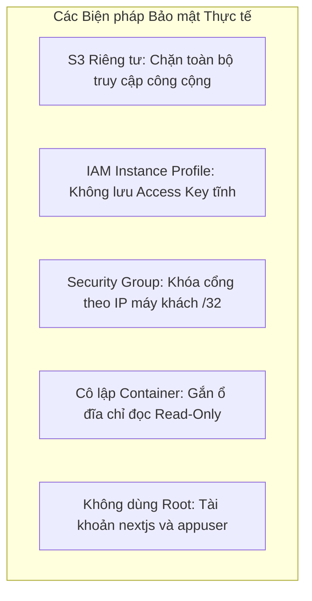

# Kiểm thử & Chất lượng

### 5.5.1 Thu thập Nhật ký Container & Metrics Hệ thống

Hệ thống giám sát vận hành được xây dựng trên nền tảng **Amazon CloudWatch Logs** và **Amazon CloudWatch Agent**:

#### 1. Nhật ký Container Có Cấu trúc (Structured Logging)
Docker daemon sử dụng `awslogs` driver để chuyển toàn bộ luồng `stdout` và `stderr` trực tiếp về các nhóm CloudWatch Log Groups riêng biệt:
- `/plant-disease/backend`: Thu thập log định dạng JSON từ middleware backend, bao gồm `request_id`, IP máy khách, phương thức HTTP, đường dẫn yêu cầu, mã trạng thái HTTP và thời gian xử lý.
- `/plant-disease/frontend`: Ghi nhận các yêu cầu tải trang Next.js, tài nguyên tĩnh và các cảnh báo lỗi render.
- **Thời gian Lưu trữ (Retention):** Được thiết lập là **7 ngày** để tối ưu hóa chi phí lưu trữ đám mây.

Truy vấn nhật ký theo thời gian thực bằng AWS CLI:

```bash
# Xem log trong 10 phút gần nhất của Backend
aws logs tail /plant-disease/backend --since 10m --region ap-southeast-2

# Lọc các dòng nhật ký chứa lỗi
aws logs filter-log-events \
  --log-group-name /plant-disease/backend \
  --filter-pattern "ERROR" \
  --region ap-southeast-2
```

#### 2. Thu thập Metrics bằng CloudWatch Agent
Mặc định dịch vụ EC2 chỉ cung cấp các chỉ số phần cứng tầng ảo hóa (như CPU). Để theo dõi RAM và ổ đĩa, **CloudWatch Agent** được cấu hình để gửi dữ liệu định kỳ mỗi 60 giây vào namespace tùy chỉnh `PlantDisease/Host`:

Tạo tệp cấu hình `/opt/aws/amazon-cloudwatch-agent/etc/amazon-cloudwatch-agent.json`:

```json
{
  "metrics": {
    "namespace": "PlantDisease/Host",
    "metrics_collected": {
      "mem": {
        "measurement": [
          "mem_used_percent"
        ],
        "metrics_collection_interval": 60
      },
      "disk": {
        "measurement": [
          "disk_used_percent"
        ],
        "metrics_collection_interval": 60,
        "resources": [
          "/"
        ]
      }
    }
  }
}
```

Khởi chạy dịch vụ CloudWatch Agent:

```bash
sudo /opt/aws/amazon-cloudwatch-agent/bin/amazon-cloudwatch-agent-ctl \
  -a fetch-config -m ec2 -s -c file:/opt/aws/amazon-cloudwatch-agent/etc/amazon-cloudwatch-agent.json

# Kiểm tra trạng thái hoạt động của agent
sudo /opt/aws/amazon-cloudwatch-agent/bin/amazon-cloudwatch-agent-ctl -a status
```

---

### 5.5.2 Cấu hình Cảnh báo Quá tải RAM

Để bảo vệ máy chủ đơn khỏi nguy cơ cạn kiệt bộ nhớ khi lưu lượng truy cập tăng đột biến, cấu hình một CloudWatch Alarm giám sát chỉ số RAM của máy chủ:

#### Thông số Cấu hình Cảnh báo

| Thuộc tính | Giá trị Thiết lập Thực tế |
|---|---|
| **Namespace** | `PlantDisease/Host` |
| **Tên Chỉ số (Metric)** | `mem_used_percent` |
| **Cách tính (Statistic)** | Trung bình (Average) |
| **Chu kỳ Đánh giá** | 60 giây (1 phút) |
| **Ngưỡng Vi phạm** | Lớn hơn **85%** (`> 85`) |
| **Số lần Vi phạm Kích hoạt** | 3 chu kỳ liên tiếp (3 datapoints) |
| **Xử lý Dữ liệu Thiếu** | Xem như dữ liệu bị thiếu (Treat missing as missing) |
| **Hành động Cảnh báo** | Gửi thông báo đến SNS Topic `plant-disease-alerts` |

Tạo topic SNS và kích hoạt cảnh báo CloudWatch bằng AWS CLI:

```bash
# 1. Tạo topic SNS
SNS_TOPIC_ARN=$(aws sns create-topic \
  --name plant-disease-alerts \
  --region ap-southeast-2 \
  --query 'TopicArn' --output text)

# 2. Đăng ký email nhận thông báo
aws sns subscribe \
  --topic-arn "$SNS_TOPIC_ARN" \
  --protocol email \
  --notification-endpoint "your-email@example.com" \
  --region ap-southeast-2

# 3. Tạo CloudWatch Alarm
aws cloudwatch put-metric-alarm \
  --alarm-name "PlantDisease-HighMemoryUtilization" \
  --alarm-description "Kích hoạt khi RAM máy chủ vượt 85% trong 3 phút liên tiếp" \
  --namespace "PlantDisease/Host" \
  --metric-name "mem_used_percent" \
  --statistic Average \
  --period 60 \
  --threshold 85 \
  --comparison-operator GreaterThanThreshold \
  --evaluation-periods 3 \
  --datapoints-to-alarm 3 \
  --alarm-actions "$SNS_TOPIC_ARN" \
  --region ap-southeast-2
```

> [!TIP]
> **Phương pháp Kiểm thử Có Kiểm soát:** Để xác minh cơ chế gửi email mà không cần làm đầy RAM thật, tạm thời hạ ngưỡng cảnh báo xuống `0%` (`--threshold 0`). Kiểm tra trạng thái alarm chuyển sang `ALARM` và có email gửi về hòm thư. Sau đó khôi phục lại ngưỡng `85%` và xác nhận trạng thái trở về `OK`.

---

### 5.5.3 Thắt chặt Bảo mật & Nguyên tắc Quyền Tối thiểu

Hạ tầng triển khai tuân thủ chặt chẽ khung nguyên tắc AWS Well-Architected Framework:



1. **Khóa Toàn bộ Quyền Public của S3:** Bật tính năng Block All Public Access. Trọng số mô hình chỉ có thể được đọc thông qua IAM Role hợp lệ của máy chủ EC2.
2. **Loại bỏ Tuyệt đối Khóa Truy cập Tĩnh:** Không lưu trữ bất kỳ access key hoặc secret key nào trong mã nguồn hoặc tệp cấu hình trên máy chủ.
3. **Gắn Ổ đĩa Chỉ Đọc (Read-Only Mount):** Thư mục tệp mô hình `/app/artifacts` được gắn vào container với cờ `:ro`, ngăn chặn triệt để nguy cơ tệp mô hình bị ghi đè hoặc chỉnh sửa.
4. **Thực thi bằng Tài khoản Phổ thông:** Các image production chạy hoàn toàn dưới tài khoản người dùng hạn chế quyền (`nextjs` UID 1001 và `appuser`).


