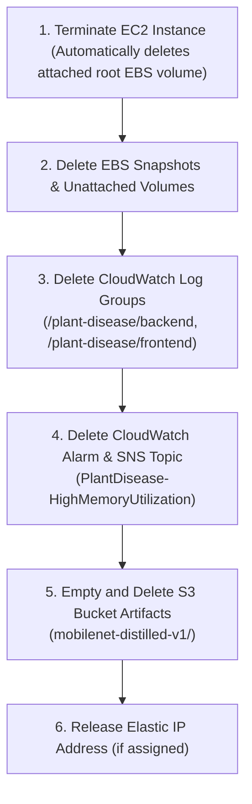

# Operations & Cleanup

### Daily Operational Routine

In a learning, research, or proof-of-concept environment, continuous 24/7 EC2 execution accumulates unnecessary hourly compute costs. Establish a disciplined routine for pausing and resuming workloads:

#### 1. Pausing Applications Between Sessions
When halting daily development, pause the container runtime and stop the underlying EC2 instance:

```bash
# On EC2 Host via SSH: Gracefully stop application containers
sudo docker stop plant-disease-frontend plant-disease-api

# From Operator Terminal or AWS CloudShell: Stop the EC2 instance
aws ec2 stop-instances \
  --instance-ids "$INSTANCE_ID" \
  --region ap-southeast-2
```

> [!NOTE]
> Stopping an EC2 instance halts hourly EC2 compute billing. Attached Amazon EBS root volumes, stored CloudWatch metrics, and S3 objects remain intact but continue to incur standard low-cost storage fees.

#### 2. Resuming Operations
When resuming work, restart the instance and initialize services in the correct dependency sequence:

```bash
# 1. Start EC2 instance
aws ec2 start-instances --instance-ids "$INSTANCE_ID" --region ap-southeast-2

# 2. Reconnect via SSH (Note: Public IPv4 may change unless using an Elastic IP)
ssh -i key.pem ec2-user@<NEW_PUBLIC_IP>

# 3. Start Backend first and await readiness
sudo docker start plant-disease-api
curl --retry 5 --retry-connrefused http://127.0.0.1:8000/health

# 4. Start Frontend
sudo docker start plant-disease-frontend
```

> [!IMPORTANT]
> If your EC2 instance does not have an allocated Elastic IP (EIP), stopping and restarting the instance assigns a **new public IPv4 address**. You must update your SSH connection string, client browser URL, and backend `CORS_ORIGINS` setting accordingly.

---

### Complete Teardown & Resource Deletion Checklist

At the conclusion of the workshop or project lifecycle, execute the following teardown procedure to ensure zero residual billing across your AWS account:



#### Step-by-Step Deletion Commands:

```bash
# 1. Terminate the EC2 instance
aws ec2 terminate-instances \
  --instance-ids "$INSTANCE_ID" \
  --region ap-southeast-2

# 2. Delete CloudWatch Log Groups
aws logs delete-log-group \
  --log-group-name /plant-disease/backend \
  --region ap-southeast-2

aws logs delete-log-group \
  --log-group-name /plant-disease/frontend \
  --region ap-southeast-2

# 3. Delete CloudWatch Alarm
aws cloudwatch delete-alarms \
  --alarm-names "PlantDisease-HighMemoryUtilization" \
  --region ap-southeast-2

# 4. Delete SNS Topic
aws sns delete-topic \
  --topic-arn "$SNS_TOPIC_ARN" \
  --region ap-southeast-2

# 5. Empty and delete S3 Bucket
aws s3 rm "s3://$MODEL_BUCKET" --recursive
aws s3api delete-bucket --bucket "$MODEL_BUCKET" --region ap-southeast-2

# 6. Release Elastic IP (if allocated)
aws ec2 release-address --allocation-id "$EIP_ALLOC_ID" --region ap-southeast-2
```

---

### References & Documentation

The architectural designs, performance benchmarks, and implementation decisions in this workshop adhere to the following technical references:

1. **[1] Project Repository & Release Artifacts:** [starkkk1/plant-disease-detection](https://github.com/starkkk1/plant-disease-detection) — Complete training notebooks, model export scripts, and Next.js / FastAPI source code.
2. **[2] AWS EC2 Stop and Start Lifecycle:** [AWS Documentation on Instance Lifecycle](https://docs.aws.amazon.com/AWSEC2/latest/UserGuide/ec2-instance-lifecycle.html) — Details on state preservation, ephemeral storage behavior, and public IP reassignments.
3. **[3] Amazon S3 HeadObject and Least-Privilege IAM:** [S3 Security Best Practices](https://docs.aws.amazon.com/AmazonS3/latest/userguide/security-best-practices.html) — Policy scoping for model weight downloads and bucket isolation.
4. **[4] Amazon CloudWatch Agent Installation:** [CloudWatch Agent User Guide](https://docs.aws.amazon.com/AmazonCloudWatch/latest/monitoring/Install-CloudWatch-Agent.html) — Custom metrics collection for host RAM and disk percent.
5. **[5] Amazon CloudWatch Alarm Actions & Amazon SNS:** [Using Amazon CloudWatch Alarms](https://docs.aws.amazon.com/AmazonCloudWatch/latest/monitoring/AlarmThatSendsEmail.html) — Configuring high-priority notification triggers for operations teams.
