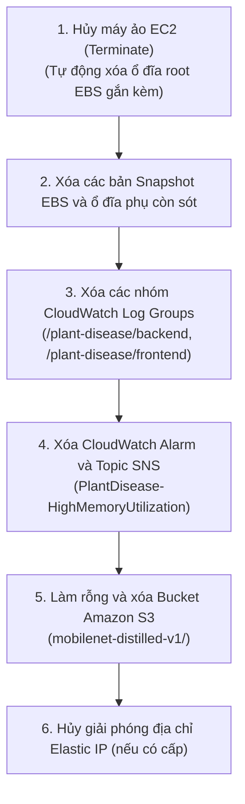

# Thu hồi Tài nguyên & Vận hành Hằng ngày

### Quy trình Vận hành Tiết kiệm Chi phí Hằng ngày

Trong môi trường học tập, nghiên cứu hoặc thử nghiệm (PoC), việc duy trì máy chủ EC2 hoạt động 24/7 sẽ gây phát sinh chi phí tính theo giờ không cần thiết. Cần xây dựng quy trình tạm dừng và kích hoạt lại hệ thống một cách có kỷ luật:

#### 1. Tạm dừng Ứng dụng Giữa các Buổi Thực hành
Khi kết thúc phiên làm việc trong ngày, dừng các container và tạm dừng máy ảo EC2:

```bash
# Trên máy chủ EC2 qua SSH: Dừng các container ứng dụng một cách an toàn
sudo docker stop plant-disease-frontend plant-disease-api

# Từ máy trạm hoặc AWS CloudShell: Tạm dừng máy ảo EC2
aws ec2 stop-instances \
  --instance-ids "$INSTANCE_ID" \
  --region ap-southeast-2
```

> [!NOTE]
> Thao tác tạm dừng (stop) máy ảo EC2 sẽ ngắt hoàn toàn việc tính phí năng lực tính toán CPU/RAM. Ổ đĩa Amazon EBS gắn kèm, các tệp log và đối tượng lưu trên S3 vẫn được giữ nguyên trạng nhưng tiếp tục tính phí lưu trữ với mức chi phí rất thấp.

#### 2. Kích hoạt Lại Hệ thống
Khi bắt đầu buổi làm việc tiếp theo, khởi động lại máy ảo và kích hoạt các dịch vụ theo đúng trình tự phụ thuộc:

```bash
# 1. Khởi động lại máy ảo EC2
aws ec2 start-instances --instance-ids "$INSTANCE_ID" --region ap-southeast-2

# 2. Kết nối lại SSH (Lưu ý: Địa chỉ Public IPv4 có thể thay đổi nếu không dùng Elastic IP)
ssh -i key.pem ec2-user@<IP_MỚI>

# 3. Khởi chạy Backend trước và đợi hệ thống sẵn sàng
sudo docker start plant-disease-api
curl --retry 5 --retry-connrefused http://127.0.0.1:8000/health

# 4. Khởi chạy Frontend
sudo docker start plant-disease-frontend
```

> [!IMPORTANT]
> Nếu máy ảo EC2 không được gán một địa chỉ Elastic IP (EIP) tĩnh, mỗi lần stop/start máy ảo sẽ được AWS cấp một **địa chỉ Public IPv4 mới**. Cần cập nhật lại câu lệnh SSH, địa chỉ mở web trên trình duyệt và cấu hình biến `CORS_ORIGINS` của backend cho phù hợp.

---

### Quy trình Thu hồi Hoàn toàn Tài nguyên Đám mây

Khi kết thúc khóa thực tập hoặc hoàn thành báo cáo workshop, thực hiện quy trình giải phóng hoàn toàn hạ tầng để đưa chi phí tài nguyên phát sinh về mức 0:



#### Các Lệnh Dọn dẹp Tài nguyên Thực tế:

```bash
# 1. Xóa máy ảo EC2
aws ec2 terminate-instances \
  --instance-ids "$INSTANCE_ID" \
  --region ap-southeast-2

# 2. Xóa các nhóm CloudWatch Log Groups
aws logs delete-log-group \
  --log-group-name /plant-disease/backend \
  --region ap-southeast-2

aws logs delete-log-group \
  --log-group-name /plant-disease/frontend \
  --region ap-southeast-2

# 3. Xóa CloudWatch Alarm
aws cloudwatch delete-alarms \
  --alarm-names "PlantDisease-HighMemoryUtilization" \
  --region ap-southeast-2

# 4. Xóa Topic SNS
aws sns delete-topic \
  --topic-arn "$SNS_TOPIC_ARN" \
  --region ap-southeast-2

# 5. Làm rỗng và xóa Bucket S3
aws s3 rm "s3://$MODEL_BUCKET" --recursive
aws s3api delete-bucket --bucket "$MODEL_BUCKET" --region ap-southeast-2

# 6. Giải phóng địa chỉ Elastic IP (nếu có)
aws ec2 release-address --allocation-id "$EIP_ALLOC_ID" --region ap-southeast-2
```

---

### Tài liệu Tham khảo

Các quyết định kiến trúc, tiêu chuẩn đo lường và quy trình vận hành trong workshop được căn cứ trên các tài liệu kỹ thuật chính thức:

1. **[1] Kho mã nguồn Dự án & Bản phát hành:** [starkkk1/plant-disease-detection](https://github.com/starkkk1/plant-disease-detection) — Mã nguồn đầy đủ của pipeline huấn luyện, FastAPI backend, Next.js frontend và các tệp cấu hình triển khai.
2. **[2] Vòng đời Bật/Tắt Amazon EC2:** [Tài liệu AWS về Vòng đời Máy ảo](https://docs.aws.amazon.com/AWSEC2/latest/UserGuide/ec2-instance-lifecycle.html) — Chi tiết về bảo toàn dữ liệu EBS và thay đổi địa chỉ IP công cộng.
3. **[3] Amazon S3 HeadObject và Phân quyền Tối thiểu:** [Thực hành An toàn trên Amazon S3](https://docs.aws.amazon.com/AmazonS3/latest/userguide/security-best-practices.html) — Phương pháp phân quyền chặt chẽ cho tác vụ tải tệp trọng số mô hình.
4. **[4] Hướng dẫn Cài đặt CloudWatch Agent:** [Tài liệu Hướng dẫn CloudWatch Agent](https://docs.aws.amazon.com/AmazonCloudWatch/latest/monitoring/Install-CloudWatch-Agent.html) — Thu thập chỉ số phần cứng bộ nhớ RAM và tỷ lệ sử dụng đĩa.
5. **[5] Thiết lập Hành động Cảnh báo CloudWatch & SNS:** [Sử dụng Cảnh báo CloudWatch](https://docs.aws.amazon.com/AmazonCloudWatch/latest/monitoring/AlarmThatSendsEmail.html) — Kích hoạt email thông báo sự cố cho đội ngũ kỹ sư vận hành.
