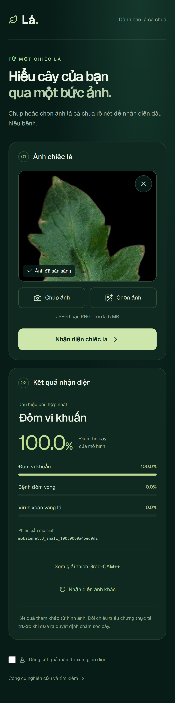
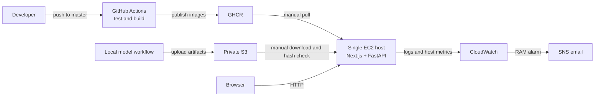

# AWS Deployment Workshop Report
## Tomato Leaf Disease Classification with EC2, S3, and CloudWatch

> **Region:** Asia Pacific (Sydney) `ap-southeast-2`  
> **Source Repository:** [starkkk1/plant-disease-detection](https://github.com/starkkk1/plant-disease-detection)  
> **Deployment Status:** Single-instance AWS demonstration deployment 
> **Target Workshop Completion:** November 27, 2026 (before the November 30 deadline)

---

### Executive Summary

The **Plant Disease Detection** project has progressed from local PyTorch experiments to a working containerized demonstration on Amazon Web Services (AWS). The deployment shows how the model can be served through a web application and monitored on a small cloud setup; it is not a production service or a validated agricultural diagnostic product.

A single **Amazon EC2** instance runs a responsive **Next.js** frontend and a **FastAPI CPU inference service** in separate containers. **Amazon S3** stores the model artifacts, while **Amazon CloudWatch** and **Amazon SNS** provide logs, host metrics, and a RAM threshold email alert. Deployment and rollback are manual. The setup has one host, limited access controls, and no high availability; model results have not been validated for field use.

---

### Recorded Configuration

| Configuration Item | Recorded Specification |
|---|---|
| **AWS Region** | Asia Pacific Sydney / `ap-southeast-2` |
| **Primary AWS Services** | Amazon EC2, Amazon S3, Amazon CloudWatch |
| **Supporting Services** | AWS IAM, Amazon VPC, Security Groups, Amazon SNS |
| **Application Stack** | Next.js Standalone (Node.js 22), FastAPI, PyTorch (CPU), Docker, GHCR |
| **Deployment Model** | One EC2 host with two containers; manual deployment and rollback |
| **Machine Learning Architecture** | Knowledge-distilled MobileNetV3-Small (Student) from ConvNeXt-Tiny (Teacher) |
| **Monitoring Scope** | Custom CloudWatch Agent (CPU, RAM, Disk metrics) + Automated RAM Alarm (>85%) |

---

### Deployment Overview

The diagram summarizes the release path. Detailed architecture is in [5.3](5.3-architecture-design/); manual deployment steps are in [5.4](5.4-deployment-strategy/).

---

### Workshop Sections

1. **[5.1 Introduction](5.1-workshop-overview/)**
   Introduction to the 11-class tomato leaf classification problem, knowledge distillation benchmarks, and Grad-CAM++ explainability.
2. **[5.2 Prerequisites & Setup](5.2-prerequiste/)**
   AWS account configuration, VPC subnets, client-restricted Security Groups, IAM Instance Profiles, and Docker engine setup.
3. **[5.3 Architecture & Design](5.3-architecture-design/)**
   System boundaries, component roles, single-host design, and how S3 artifacts connect to the API runtime.
4. **[5.4 Deployment Strategy](5.4-deployment-strategy/)**
   CI image publishing, manual model-artifact retrieval and hash verification, container startup, and application checks.
5. **[5.5 Monitoring & Security](5.5-quality-assurance/)**
   Container logs, CloudWatch host metrics and RAM alerts, plus the access and container controls used in the demo.
6. **[5.6 Operations & Cleanup](5.6-operations-cleanup/)**
   Daily start/stop procedures, public IP updates, removal of demo resources, and a final check for leftover billable resources.
