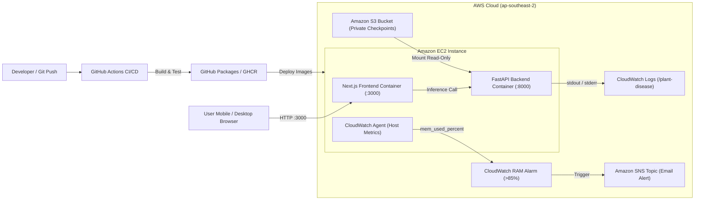

# AWS Deployment Workshop Report
## Tomato Leaf Disease Classification with EC2, S3, and CloudWatch

> **Region:** Asia Pacific (Sydney) `ap-southeast-2`  
> **Source Repository:** [starkkk1/plant-disease-detection](https://github.com/starkkk1/plant-disease-detection)  
> **Deployment Status:** Containerized Production Demonstration on AWS

---

### Executive Summary

The **Plant Disease Detection** project has successfully progressed from local PyTorch research to a containerized, production-grade cloud deployment on Amazon Web Services (AWS). 

A single **Amazon EC2** instance hosts a responsive **Next.js** web frontend and a high-performance **FastAPI CPU inference service**. **Amazon S3** provides secure, decoupled storage for versioned deep learning model weights, while **Amazon CloudWatch** and **Amazon SNS** collect real-time operational telemetry, host metrics, and dispatch proactive memory saturation alarms.

---

### Recorded Configuration

| Configuration Item | Recorded Specification |
|---|---|
| **AWS Region** | Asia Pacific Sydney / `ap-southeast-2` |
| **Primary AWS Services** | Amazon EC2, Amazon S3, Amazon CloudWatch |
| **Supporting Services** | AWS IAM, Amazon VPC, Security Groups, Amazon SNS |
| **Application Stack** | Next.js Standalone (Node.js 20), FastAPI, PyTorch (CPU), Docker, GHCR |
| **Deployment Model** | Single host with dual isolated containers; manual release promotion |
| **Machine Learning Architecture** | Knowledge-distilled MobileNetV3-Small (Student) from ConvNeXt-Tiny (Teacher) |
| **Monitoring Scope** | Custom CloudWatch Agent (CPU, RAM, Disk metrics) + Automated RAM Alarm (>85%) |

---

### End-to-End Operational Pipeline

---

### Workshop Sections

1. **[5.1 Workshop Overview & Deep Learning System](5.1-workshop-overview/)**  
   Introduction to the 11-class tomato leaf classification problem, knowledge distillation benchmarks, and Grad-CAM++ explainability.
2. **[5.2 Prerequisites & Environment Preparation](5.2-prerequiste/)**  
   AWS account configuration, VPC subnets, client-restricted Security Groups, IAM Instance Profiles, and Docker engine setup.
3. **[5.3 Architecture Design & S3 Model Storage](5.3-architecture-design/)**  
   Decoupled model artifact architecture, S3 bucket security, IAM assumed-role validation, and SHA256 integrity verification.
4. **[5.4 Containerized Application Deployment](5.4-deployment-strategy/)**  
   Multi-stage Docker builds, runtime environment configuration, Next.js standalone serving, and live inference validation with real leaf fixtures.
5. **[5.5 Monitoring and Access Control](5.5-quality-assurance/)**  
   Structured JSON container logging with AWSlogs driver, CloudWatch Agent memory telemetry, automated RAM breach alarms, and least-privilege security.
6. **[5.6 Clean Up and Daily Operations](5.6-operations-cleanup/)**  
   Daily container start/stop procedures, dynamic public IP management, and complete cloud resource teardown checklist.
