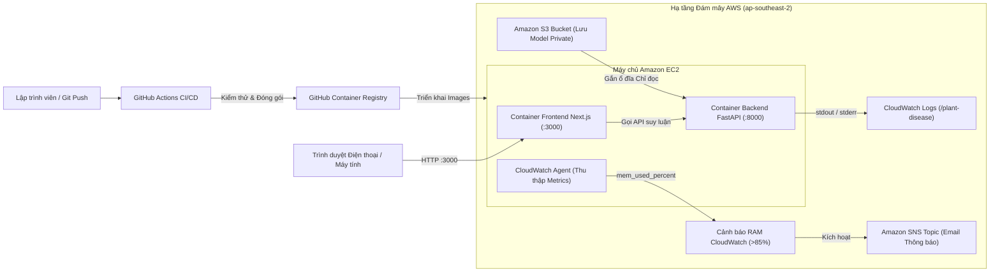

# Báo cáo Workshop Triển khai Ứng dụng trên AWS
## Phân loại Bệnh lá Cà chua với EC2, S3 và CloudWatch

> **Khu vực (Region):** Châu Á - Thái Bình Dương (Sydney) `ap-southeast-2`  
> **Kho mã nguồn:** [starkkk1/plant-disease-detection](https://github.com/starkkk1/plant-disease-detection)  
> **Trạng thái triển khai:** Bản demo chạy container hoàn chỉnh trên hạ tầng AWS

---

### Tóm tắt Tổng quan

Dự án **Nhận diện Bệnh lá Cây trồng (Plant Disease Detection)** đã hoàn thành lộ trình chuyển đổi từ mô hình nghiên cứu PyTorch cục bộ sang giải pháp triển khai đám mây hoàn chỉnh bằng container trên Amazon Web Services (AWS).

Một máy ảo **Amazon EC2** đóng vai trò máy chủ lưu trữ cho hai container độc lập: giao diện web **Next.js** có thiết kế responsive tối ưu cho thiết bị di động và dịch vụ suy luận trí tuệ nhân tạo **FastAPI CPU**. Dịch vụ **Amazon S3** đảm bảo lưu trữ an toàn, tách biệt cho các tệp trọng số mô hình đã qua kiểm thử mã băm, trong khi **Amazon CloudWatch** và **Amazon SNS** phụ trách giám sát tài nguyên hệ thống theo thời gian thực và tự động phát cảnh báo khi bộ nhớ tiệm cận ngưỡng quá tải.

---

### Bảng Thông số Cấu hình Ghi nhận

| Hạng mục | Cấu hình Thực tế Được Ghi Nhận |
|---|---|
| **Khu vực AWS (Region)** | Asia Pacific Sydney / `ap-southeast-2` |
| **Dịch vụ AWS Chính** | Amazon EC2, Amazon S3, Amazon CloudWatch |
| **Dịch vụ Hỗ trợ** | AWS IAM, Amazon VPC, Security Groups, Amazon SNS |
| **Ngăn xếp Ứng dụng (Stack)** | Next.js Standalone (Node.js 20), FastAPI, PyTorch (CPU), Docker, GHCR |
| **Mô hình Triển khai** | Một máy chủ EC2 chạy 2 container độc lập; chuyển phiên bản thủ công |
| **Kiến trúc Trí tuệ Nhân tạo** | MobileNetV3-Small (Student) được chưng cất tri thức từ ConvNeXt-Tiny (Teacher) |
| **Phạm vi Giám sát** | CloudWatch Agent (CPU, RAM, Đĩa) + 1 Cảnh báo RAM tự động (>85%) |

---

### Sơ đồ Quy trình Vận hành Toàn diện

---

### Lộ trình Nội dung Workshop

1. **[5.1 Tổng quan Workshop & Hệ thống Deep Learning](5.1-workshop-overview/)**  
   Giới thiệu bài toán phân loại 11 bệnh lá cà chua, cơ chế chưng cất tri thức mô hình và tính năng giải thích quyết định bằng Grad-CAM++.
2. **[5.2 Điều kiện Chuẩn bị & Thiết lập Môi trường](5.2-prerequiste/)**  
   Cấu hình tài khoản AWS, thiết lập mạng VPC, phân quyền Security Group theo IP máy khách, IAM Instance Profile và cài đặt Docker Engine.
3. **[5.3 Thiết kế Kiến trúc & Lưu trữ Model trên S3](5.3-architecture-design/)**  
   Kiến trúc tách rời tệp trọng số mô hình ra S3, cấu hình bảo mật bucket, xác thực danh tính assumed-role và kiểm tra tính toàn vẹn SHA256.
4. **[5.4 Triển khai Ứng dụng bằng Container](5.4-deployment-strategy/)**  
   Đóng gói Docker nhiều giai đoạn, thiết lập môi trường thực thi, triển khai Next.js standalone và kiểm thử suy luận với ảnh lá thực tế.
5. **[5.5 Giám sát Vận hành & Kiểm soát Truy cập](5.5-quality-assurance/)**  
   Cấu hình ghi log JSON có cấu trúc qua awslogs driver, đo đạc RAM máy chủ bằng CloudWatch Agent, tạo cảnh báo RAM qua SNS và bảo mật quyền tối thiểu.
6. **[5.6 Thu hồi Tài nguyên & Vận hành Hằng ngày](5.6-operations-cleanup/)**  
   Quy trình bật/tắt container mỗi ngày, quản lý thay đổi IP public khi dừng máy ảo và quy trình giải phóng hoàn toàn tài nguyên đám mây.
