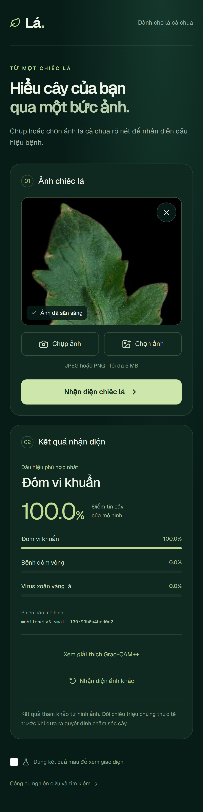
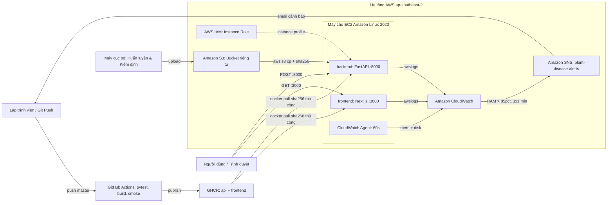

# Báo cáo Workshop Triển khai Ứng dụng trên AWS
## Phân loại Bệnh lá Cà chua với EC2, S3 và CloudWatch

> **Khu vực (Region):** Châu Á - Thái Bình Dương (Sydney) `ap-southeast-2`  
> **Kho mã nguồn:** [starkkk1/plant-disease-detection](https://github.com/starkkk1/plant-disease-detection)  
> **Trạng thái triển khai:** Bản demo trên một máy chủ AWS
> **Mốc hoàn tất workshop dự kiến:** 27/11/2026 (trước hạn 30/11)

---

### Tóm tắt Tổng quan

Dự án **Plant Disease Detection** đã chuyển từ thử nghiệm PyTorch cục bộ sang một bản demo chạy container trên Amazon Web Services (AWS). Phần triển khai cho thấy cách phục vụ mô hình qua ứng dụng web và theo dõi tài nguyên trên cấu hình đám mây nhỏ; đây chưa phải dịch vụ production hay sản phẩm chẩn đoán nông nghiệp đã được kiểm chứng.

Một máy **Amazon EC2** chạy hai container riêng biệt: giao diện **Next.js** và API suy luận CPU **FastAPI**. **Amazon S3** lưu các tệp mô hình; **Amazon CloudWatch** và **Amazon SNS** cung cấp log, metrics máy chủ và email cảnh báo theo ngưỡng RAM. Việc triển khai và quay lui phiên bản được thực hiện thủ công. Cấu hình chỉ có một máy chủ, khả năng kiểm soát truy cập còn hạn chế và chưa có tính sẵn sàng cao; kết quả mô hình chưa được kiểm định trên dữ liệu thực địa.

---

### Bảng Thông số Cấu hình Ghi nhận

| Hạng mục | Cấu hình Thực tế Được Ghi Nhận |
|---|---|
| **Khu vực AWS (Region)** | Asia Pacific Sydney / `ap-southeast-2` |
| **Dịch vụ AWS Chính** | Amazon EC2, Amazon S3, Amazon CloudWatch |
| **Dịch vụ Hỗ trợ** | AWS IAM, Amazon VPC, Security Groups, Amazon SNS |
| **Ngăn xếp Ứng dụng (Stack)** | Next.js Standalone (Node.js 22), FastAPI, PyTorch (CPU), Docker, GHCR |
| **Mô hình Triển khai** | Một máy EC2 chạy 2 container; triển khai và quay lui thủ công |
| **Kiến trúc Trí tuệ Nhân tạo** | MobileNetV3-Small (Student) được chưng cất tri thức từ ConvNeXt-Tiny (Teacher) |
| **Phạm vi Giám sát** | CloudWatch Agent (CPU, RAM, Đĩa) + 1 Cảnh báo RAM tự động (>85%) |

---

### Sơ đồ Quy trình Vận hành Toàn diện

---

### Lộ trình Nội dung Workshop

1. **[5.1 Giới thiệu](5.1-workshop-overview/)**
   Giới thiệu bài toán phân loại 11 bệnh lá cà chua, cơ chế chưng cất tri thức mô hình và tính năng giải thích quyết định bằng Grad-CAM++.
2. **[5.2 Chuẩn bị & Cài đặt](5.2-prerequiste/)**
   Cấu hình tài khoản AWS, thiết lập mạng VPC, phân quyền Security Group theo IP máy khách, IAM Instance Profile và cài đặt Docker Engine.
3. **[5.3 Kiến trúc & Thiết kế](5.3-architecture-design/)**
   Kiến trúc tách rời tệp trọng số mô hình ra S3, cấu hình bảo mật bucket, xác thực danh tính assumed-role và kiểm tra tính toàn vẹn SHA256.
4. **[5.4 Chiến lược Triển khai](5.4-deployment-strategy/)**
   Đóng gói Docker nhiều giai đoạn, thiết lập môi trường thực thi, triển khai Next.js standalone và kiểm thử suy luận với ảnh lá thực tế.
5. **[5.5 Kiểm thử & Chất lượng](5.5-quality-assurance/)**
   Cấu hình ghi log JSON có cấu trúc qua awslogs driver, đo đạc RAM máy chủ bằng CloudWatch Agent, tạo cảnh báo RAM qua SNS và bảo mật quyền tối thiểu.
6. **[5.6 Vận hành & Thu hồi](5.6-operations-cleanup/)**
   Quy trình bật/tắt container mỗi ngày, quản lý thay đổi IP public khi dừng máy ảo và quy trình giải phóng hoàn toàn tài nguyên đám mây.
